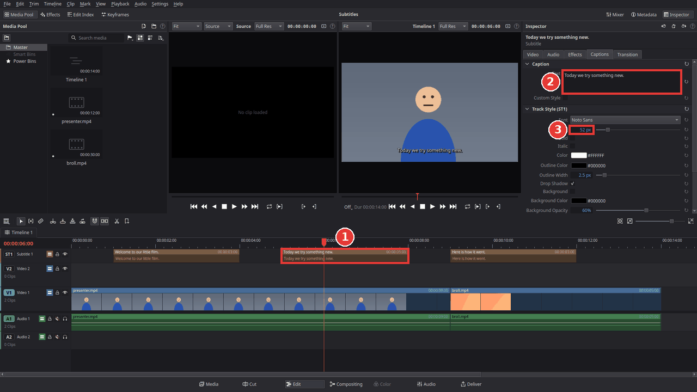
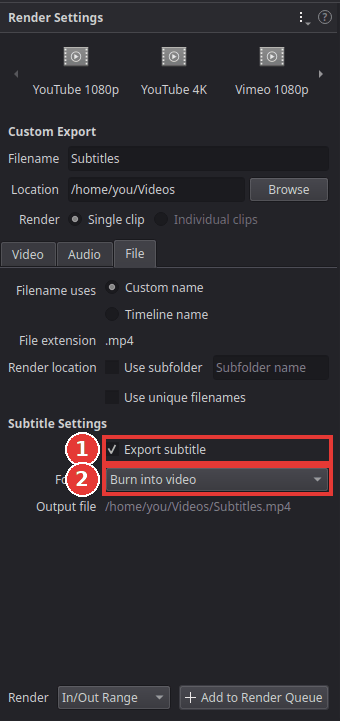

# Add subtitles

You will add subtitles (captions) to your video: type them yourself or load a subtitle file,
change how they look, and export them either burnt into the picture or as a separate file.

Subtitles live on their own track, **ST1**, above the video tracks. Each caption is a small
clip on that track: where it starts and ends on the timeline is when it shows.

## Type the captions yourself

1. Move the playhead to where the first caption should appear.
2. Choose **Timeline > Add Subtitle**. A three-second caption appears at the playhead on the
   subtitle track (1). Kinoklip creates the track **ST1** if there is none yet.
3. In the **Inspector** on the right, the **Captions** tab is open. Type the text into
   **Text** (2). Press **Enter** for a second line.

   

4. Drag the left or right edge of the caption on the timeline to change when it appears and
   disappears. Drag the whole caption to move it.
5. Repeat for the next caption.

Captions behave like other clips: you can cut, copy, paste and delete them, and they move along
when you insert or ripple-delete clips. Right-click the subtitle track's header for **Add
Subtitle** as well.

## Load a subtitle file

If you already have subtitles as an **.srt** or **.vtt** file (for example from a
transcription service):

1. Choose **File > Import > Subtitle** and pick the file. It appears in the media pool.
2. Drag it from the media pool to the very **start** of the timeline, onto the subtitle track
   (or any track: the captions always go onto a subtitle track). Each line of the file becomes
   a caption with the file's timing, counted from where you drop it.

## Change how they look

Select any caption and look further down the **Captions** tab: **Track Style (ST1)** sets the
font, size, colour, outline, shadow, background box and position (bottom, top or middle) of
every caption on the track at once (3).

To give one caption a look of its own (for example a different colour for a second speaker),
select it and tick **Custom Style**; its own settings then appear under **Caption Style**,
above the track style.

The eye button in the track header of ST1 shows or hides the captions in the viewer and in the
export.

## Export with subtitles

1. Go to the **Deliver** page (**Shift+8**) and choose your preset, as in
   [Export a video for YouTube](export-for-youtube.md).
2. Open the **File** tab of the render settings and tick **Export subtitle** (1) under
   **Subtitle Settings**.
3. Choose the **Format** (2):
   - **Burn into video**: the captions become part of the picture. Everyone sees them, and they
     cannot be switched off. Best for social media, where many people watch without sound.
   - **As a separate file**: an **.srt** (or WebVTT) file is saved next to the video, with the
     same name. Upload it to YouTube as subtitles; viewers can switch them on and off.
   - **As embedded captions**: the captions go into the video file as a subtitle stream
     (MP4, QuickTime, MKV and WebM). Video players can switch them on and off.

   

4. Click **Add to Render Queue** and then **Render All**.

## Tips

- **Readable captions:** keep each caption to one or two short lines and show it for at least
  one to two seconds.
- **Several languages:** add a second subtitle track (**Timeline > Add Subtitle Track**) for
  each language. With **As a separate file**, every track is saved as its own file.
- Kinoklip cannot make subtitles from speech automatically yet. A transcription service or
  program can make an .srt file for you to import.

## If something goes wrong

- **The captions do not show in the viewer.** Check the eye button in the header of the
  subtitle track; it must be on.
- **The imported captions are too late or too early.** They are timed from where you dropped
  the file. Undo (**Ctrl+Z**) and drop it again exactly at the start of the timeline.
- **Export subtitle cannot be ticked or the format is missing.** Some formats (for example
  image sequences or audio files) cannot carry subtitles; choose an MP4 or QuickTime preset.
