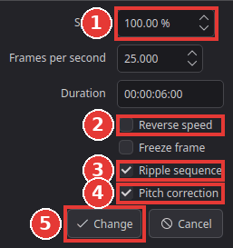
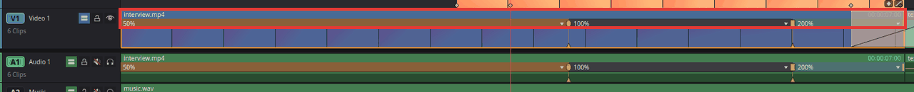

# Speed up or slow down a clip

You will make a clip play in slow motion or faster, either at one speed for the whole clip or
with a smooth change of speed in the middle (a "speed ramp").

Speed is given in percent: **100 %** is normal, **50 %** is half speed (slow motion, the clip
gets twice as long), **200 %** is double speed (the clip gets half as long).

## One speed for the whole clip

1. Click the clip on the timeline to select it.
2. Choose **Clip > Change Clip Speed** (**R**). A small window opens.

   

3. Type the new **Speed** (1), for example `50` for slow motion or `200` to make it faster.
   **Frames per second** and **Duration** change along with it; you can type in those instead
   if that is easier (for example a duration the clip must fit).
4. Check the options:
   - **Reverse speed** (2): plays the clip backwards.
   - **Ripple sequence** (3): on, the clips after it move so that no gap or overlap appears.
     Off, the clip keeps its length on the timeline.
   - **Pitch correction** (4): on, voices keep their normal pitch at the new speed. Off, they
     sound higher when faster and lower when slower.
5. Click **Change** (5).

For small steps, **Clip > Increase Clip Speed by 10%** and **Clip > Decrease Clip Speed by
10%** change the speed of the selected clips without opening the window.

## A speed ramp: slow down and speed up inside a clip

1. Select the clip and choose **Clip > Retime Controls** (**Ctrl+R**). A speed bar appears
   along the top of the clip, showing its speed (100 % at first).
2. Move the playhead to where the speed should change.
3. Click the small arrow in the speed bar and choose **Add Speed Point**. The clip is now split
   into two parts (segments), each with its own speed.
4. Click the arrow in the part you want to change and choose a speed under **Change Speed**, for
   example 50 %.

   

5. For a smooth change instead of a jump, right-click the speed point (the line between two
   parts) and choose **Smooth Ramp**.
6. To fine-tune, drag the handle at the bottom of a speed point left or right: the part before it
   gets slower or faster. Drag the handle at the top to move where the speed changes.
7. Press **Ctrl+R** again to hide the retime controls.

To start over, choose **Reset Clip** in the speed menu.

## Tips

- **Freeze a frame:** move the playhead to the frame and press **Shift+R** (**Clip > Freeze
  Frame**). The whole clip then shows that one frame. To freeze for just a moment inside a clip,
  use **Freeze Frame** in the speed menu of the retime controls: it adds a one-second freeze at
  the playhead. More in [Freeze a frame](freeze-a-frame.md).
- **Smoother slow motion:** footage slowed down a lot can look jerky, because every frame is
  shown several times. In the speed menu, choose **Retime Process > Frame Blend** (mixes
  neighbouring frames) or **Optical Flow** (creates new in-between frames; best for smooth
  motion, slower to play). Slow motion looks best when it was filmed at a high frame rate
  (50 or 60 frames per second and up).
- **Play a clip backwards:** tick **Reverse speed** in **Change Clip Speed**, or choose **Reverse
  Segment** in the speed menu for only one part.

## If something goes wrong

- **The clip got longer and pushed everything after it.** That is **Ripple sequence**. Undo
  (**Ctrl+Z**) and change the speed again with **Ripple sequence** off.
- **The sound is gone.** Frozen and reversed parts have no sound.
