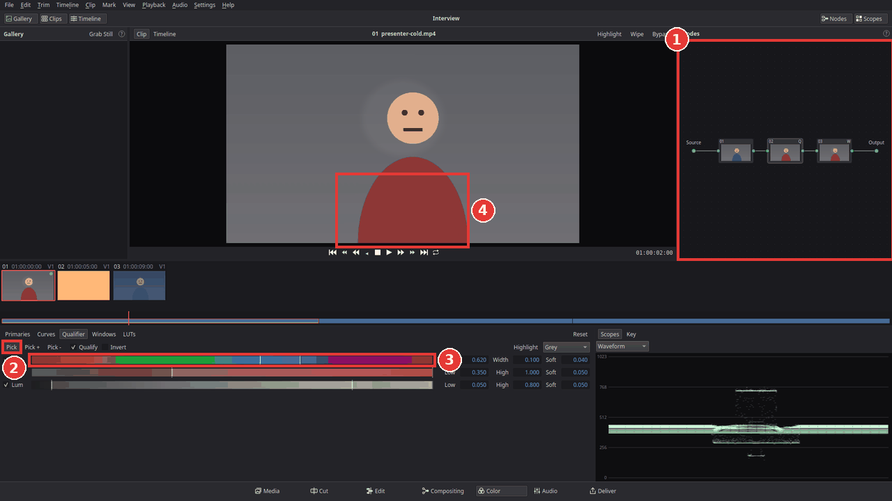
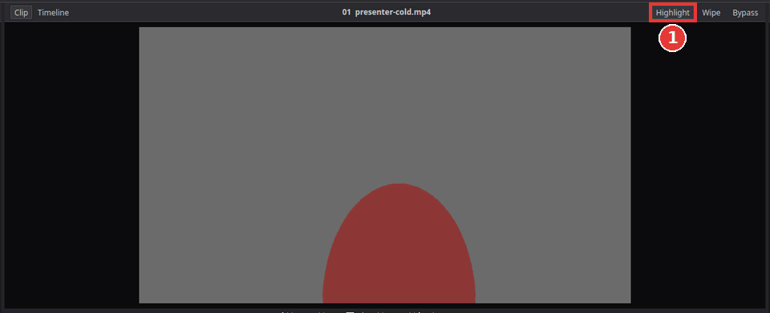
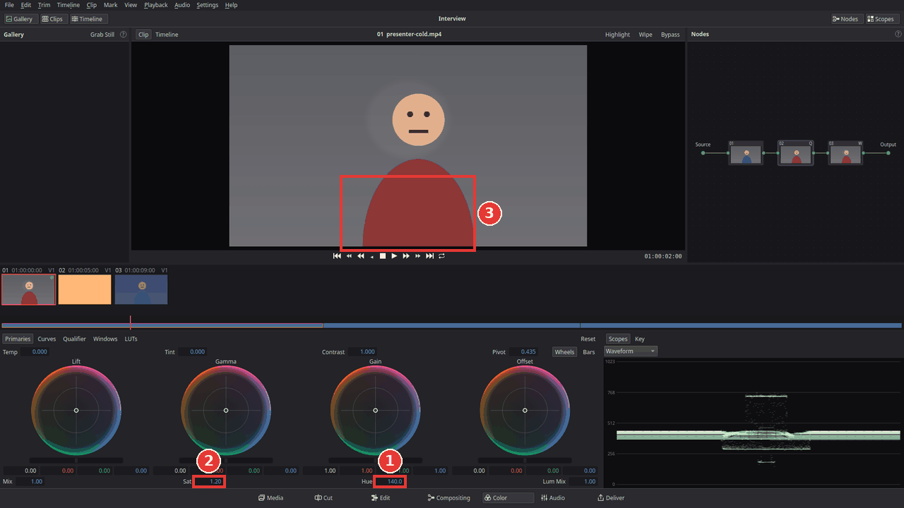
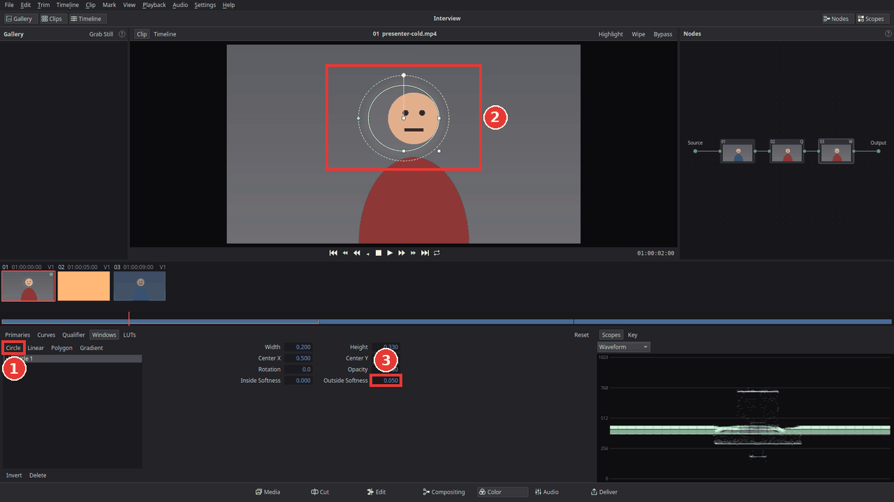

# Change the colour of one object

On the Color page you can change one colour or one part of the picture and leave the rest
alone: turn a blue shirt red, make the sky bluer, or brighten a face. Two tools pick the part
to change:

- the **qualifier** picks by colour (everything that is "this blue");
- a **window** picks by place (everything inside a circle or a rectangle).

You can use either one or both together. If you have not used the Color page yet, read
[Colour correct a clip](colour-correct-a-clip.md) first.

## Add a node for the change

Fix the whole picture first (brightness and white balance) in node **01**. Then do the change
of one object in a node of its own, so each node does one job and you can switch it off on its
own:

1. Open the clip on the Color page (**Shift+6**).
2. Click node **01** in the Nodes panel (1 in the picture below).
3. Press **Alt+S** (or choose **Color > Add Serial Node**, or right-click in the Nodes panel and
   choose **Add Serial Node**). Node **02** appears after node 01 and is selected. A serial node
   works on the picture that comes out of the node before it.

## Pick the colour with the qualifier

1. Click **Qualifier** in the bar above the palettes.
2. Click **Pick** (2). The pointer over the viewer becomes an eyedropper.
3. In the viewer, click the object whose colour you want to change (4), or drag a small
   rectangle over it to pick a range of shades at once.

   

4. The **Hue**, **Sat** and **Lum** bars (3) now show the picked range: Hue is the colour,
   Sat how strong it is, Lum how bright. **Qualify** is ticked, so node 02 now changes only
   those colours.
5. Click **Pick** again when you are done, so a click in the viewer does not pick again.

## See what is selected (Highlight)

Click **Highlight** above the viewer (**Shift+H**, 1 below). The viewer shows only the selected
part in its colours and the rest grey. In the Qualifier palette, the menu next to its own
**Highlight** button switches to **Black / White**: the selected part white, the rest black.

The selection is rarely perfect at the first click. To make it better:
- Click **Pick +** and click parts of the object that are missing (folds, shadows).
- Click **Pick -** and click things that should not be selected.
- Drag the ends of the ranges on the **Hue**, **Sat** and **Lum** bars, or type into their
  fields. **Soft** makes the edge of the selection softer, which hides hard, noisy edges.
- Untick **Hue**, **Sat** or **Lum** to ignore that one.

Click **Highlight** again to see the normal picture.

## Change the colour

1. Click **Primaries** in the bar above the palettes. Node 02 is still selected.
2. Drag the **Hue** field (1) at the bottom of the palette: the selected colour turns round the
   colour wheel (for example blue to red), the rest of the picture stays the same.
3. Use **Sat** (2) to make the colour stronger or weaker, and the wheels to make it brighter or
   darker.

To check the change, select node 02 and press **Ctrl+D** to switch it off and on.

**Make one colour pop:** to keep one colour and turn everything else black and white, pick the
colour as above, tick **Invert** in the Qualifier palette (now everything *except* that colour
is selected) and set **Sat** in the Primaries palette to 0.

## Limit it to one place with a window

Sometimes the same colour is also somewhere else in the picture (a blue car behind the blue
shirt), or you want to change a place, not a colour: brighten a face, darken a bright sky.
That is what windows do.

1. Select the node that should get the window, or press **Alt+S** for a new one.
2. Click **Windows** in the bar above the palettes and click **Circle** (1). A circle appears
   in the viewer (2).
3. Drag inside the circle to move it over the face or object. Drag the handles on its sides to
   make it wider or taller, the corner handle for both, and the round knob above it to turn it.
4. Drag the small diamond on its left (or change **Outside Softness**, 3) to make the edge softer, so
   the change fades out and no edge is visible.
5. Click **Primaries** and make the change, for example raise **Gamma** a little to brighten
   the face. Only the inside of the circle changes.

The window controls show in the viewer only while the **Windows** palette is shown. Other
shapes are **Linear** (a rectangle), **Polygon** (drag its points; double-click an edge to add
one, right-click a point to remove it) and **Gradient** (a soft straight edge, good for a sky).
Click **Invert** to change everything *outside* the window instead.

In a node with both a qualifier and a window, only the colours you picked *inside* the window
change. That is how you change the blue shirt but not the blue car behind it.

## Tips

- **The node marks:** nodes with a qualifier show **Q**, nodes with a window **W**.
- **Undo** any step with **Ctrl+Z**. To remove a node, select it and press **Delete**.
- **A window does not follow movement yet** (there is no tracker). If the object moves, make
  the window big enough to cover it for the whole clip, with a soft edge, or split the clip and
  place the window again in each part.
- **Other node types:** **Alt+P** adds a parallel node (two nodes that both work on the same
  picture, their results mixed equally) and **Alt+L** a layer node (each node's change laid
  over the one before, the last on top). For most work, serial nodes are all you need.

## If something goes wrong

- **Pick does nothing.** The Qualifier palette must be shown and **Pick** pressed in. The
  pick goes to the node selected in the Nodes panel.
- **The whole picture changes, not just the object.** Make sure the change is in the node
  with the qualifier or window (its tile shows **Q** or **W**), not in node 01.
- **The edges look noisy or hard.** Raise **Soft** in the Qualifier palette or **Outside
  Softness** of the window, and use **Pick -** on the wrong parts.
- **I cannot see the window in the viewer.** Click **Windows** in the bar above the palettes;
  the window controls are hidden while other palettes are shown.
