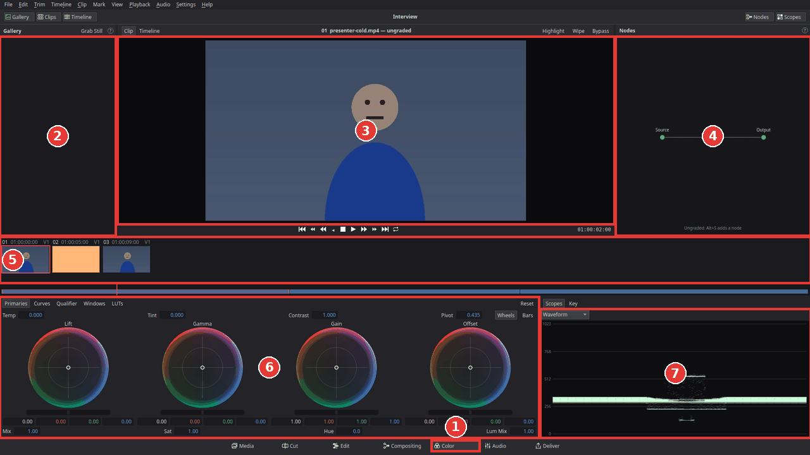
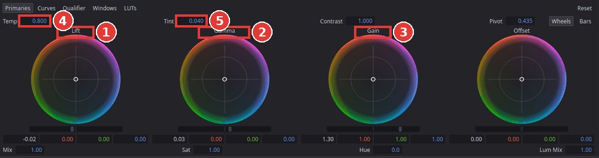
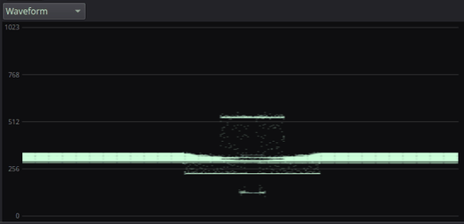
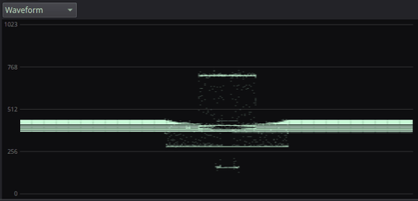
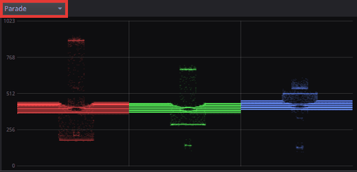
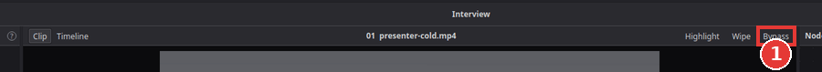
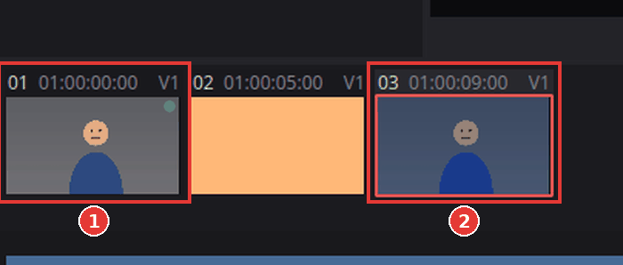
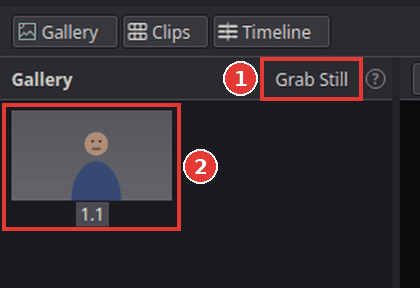

# Colour correct a clip

A shot that came out too dark, too blue or too yellow can be fixed on the **Color** page (new
in Kinoklip 1.1.0 Beta). This article shows the basics: making a clip brighter or darker,
taking out a colour cast, checking the result on the waveform, comparing with the original
and giving other clips the same correction.

What you do on the Color page is called the clip's **grade**. It stays with the clip: it plays
on the Edit page and is part of the exported video.

## Open the Color page

1. On the Edit page, put the playhead over the clip you want to correct.
2. Click **Color** in the page bar at the bottom of the window (**Shift+6**, 1 in the picture
   below).

The Color page always works on the clip under the playhead (on the highest video track that
has a clip there). To correct another clip, click it in the clips strip, or move the playhead.

The page has:
- the **Gallery** (2) on the left, which keeps saved grades ("stills");
- the **viewer** (3) in the middle, which shows the clip with its grade. The bar above the
  picture shows the clip's number and name;
- the **Nodes** panel (4) on the right. Every correction lives in a node (a numbered box). A
  clip that is not corrected yet has no nodes; you do not need to add one first, the first
  change you make creates node **01**;
- the **clips strip** (5): every clip of the timeline as a small picture, numbered in order.
  The clip you are correcting has a frame around it. Under it is a small timeline where you
  can click to move the playhead;
- the **palettes** (6) at the bottom: **Primaries**, **Curves**, **Qualifier**, **Windows**
  and **LUTs**. Click a name to show that palette;
- the **scopes** (7) at the bottom right, which measure the picture (see
  [Read the waveform](#read-the-waveform)).

## Fix the brightness

The **Primaries** palette has four colour wheels. Each wheel has a ring with a dot in the
middle (for colour) and a bar under the ring (for brightness):

- **Lift** (1) changes the dark parts of the picture (shadows);
- **Gamma** (2) changes the middle tones (faces, walls, most of a normal picture);
- **Gain** (3) changes the bright parts (highlights, the sky);
- **Offset** moves everything at once.

To make a dark clip brighter:

1. Click **Primaries** in the bar above the palettes (it is shown when the page opens).
2. Drag the bar under **Gain** to the right until the brightest parts look bright but not
   washed out. Drag it to the left to make them darker.
3. If the picture now looks flat, drag the bar under **Lift** a little to the left so the
   darkest parts are black again.
4. Drag the bar under **Gamma** to brighten or darken the middle tones, for example faces.

Small changes go a long way. Hold **Shift** while you drag for fine control. To type a value
instead, double-click one of the numbers under a wheel (Y is brightness, R, G and B are the
colours). **Double-click a wheel** to set it back to neutral; double-click the bar under it to
reset only the brightness.

## Fix the colour (white balance)

A picture that looks too blue (often indoors or in the shade) or too orange (light bulbs) has
a **colour cast**. Things that should be white or grey show the cast best.

1. Find **Temp** (4) above the wheels. Drag the number to the right to make the picture warmer
   (more orange, less blue), to the left to make it cooler.
2. If the picture still looks a little green or pink, drag **Tint** (5): to the right takes
   green out (adds magenta), to the left adds green.
3. For a finer fix, drag the dot in the middle of a wheel towards the colour you want more
   of. It moves the colour of that part of the picture without changing its brightness: drag
   the **Gain** dot away from blue if only the bright parts are blue, the **Lift** dot if only
   the shadows are.

Look at something that should be neutral, such as a white wall, a grey road or a white shirt:
when it looks neutral, the cast is gone.

The other fields of the palette: **Contrast** makes darks darker and brights brighter at the
same time (**Pivot** is the brightness that stays put); **Sat** makes all colours stronger or
weaker (0 is black and white); **Hue** turns every colour round the colour wheel; **Mix**
fades the whole node in and out.

## Read the waveform

The eye gets used to a colour cast within seconds, and every monitor shows colours a little
differently. The **scopes** at the bottom right measure the picture instead.

The **Waveform** draws the picture from left to right as it is in the viewer, but upwards it
shows brightness: the bottom line (0) is black, the top line (1023) is pure white.

| Before | After |
|---|---|
|  |  |

- **Too dark:** the trace sits low and nothing comes near the top. Raise **Gain**.
- **Too bright, or "clipped":** the trace is pressed flat against the top line. The detail
  there is lost; lower **Gain**.
- **Grey and flat:** the trace sits in a narrow band in the middle. Lower **Lift** and raise
  **Gain**, or raise **Contrast**.

A normal picture has its darkest parts near the bottom and its brightest parts somewhat below
the top.

To check the colour, choose **Parade** in the menu at the top of the scope. It shows the red,
green and blue parts of the picture side by side. Where the picture shows something white or
grey, the three should be at the same height; if the blue one is higher, the picture is too
blue there.

The menu also has **Waveform RGB**, a **Vectorscope** (how strong the colours are and which
way they lean) and a **Histogram**. To see two scopes in a separate window on any page, choose
**View > Show Panel in Workspace > Video Scopes** (**Ctrl+Shift+W**).

## Compare with the original

Click **Bypass** above the viewer (**Shift+D**) to see the clip without its grade; click it
again to see the grade. The bar above the picture says "grades bypassed" while it is on.
Bypass only changes what the viewers show: the export always has the grades.

To switch off just one node, select it in the Nodes panel and press **Ctrl+D** (press it again
to switch it back on).

## Give other clips the same correction

Clips from the same camera and place usually need the same fix. There are three ways to copy
it.

**Copy and paste:**
1. In the clips strip, click the corrected clip (1 in the picture above) and press **Ctrl+C**.
2. Click the clip that should get the same correction (2). To give it to several clips at
   once, hold **Ctrl** and click each of them.
3. Press **Ctrl+V**.

**Middle-click:** click the clip that should get the correction, then click the corrected clip
with the **middle mouse button** (the mouse wheel). The selected clips get its grade.

**Gallery stills** keep a grade for later, even after you have changed the clip again:
1. Click the corrected clip, then click **Grab Still** in the Gallery's title bar
   (**Ctrl+Alt+G**, 1 below). A small picture with the grade appears in the Gallery (2).
2. Click another clip in the clips strip and double-click the still (or middle-click it). The
   clip gets that grade.
3. Right-click a still for more: **Apply Grade to Selected Clips**, **Wipe with This Still**
   (compare the current clip with the still side by side; drag the line in the viewer),
   **Rename…** and **Delete Still**.

Stills are saved with the project.

## Tips

- **Start over:** choose **Color > Reset Node Grade** to reset the selected node, or
  **Color > Reset Clip Grade** to remove the whole grade of the clip. **Ctrl+Z** undoes every
  step.
- **One look for the whole video:** click **Timeline** above the viewer (left of the clip name)
  to grade the whole timeline. That grade comes after the clips' own grades, so it is the place
  for a final look; click **Clip** to go back to the clip.
- **Curves:** the **Curves** palette shapes brightness more freely: click the line to add a
  point and drag it (a gentle "S" adds contrast). Double-click or right-click a point to
  remove it.
- **Fix one part of the picture only:** see
  [Change the colour of one object](change-the-colour-of-one-object.md).
- **A ready-made look:** see [Use a LUT](use-a-lut.md).

## If something goes wrong

- **The viewer says "No clip under the playhead".** Move the playhead over a clip: click in the
  small timeline under the clips strip, or click a clip in the strip.
- **The wrong clip changes.** The Color page corrects the clip with the frame around it in the
  clips strip, which is the top clip under the playhead. A title or a picture-in-picture on a
  higher track is graded instead of the clip under it; click the clip you want in the strip.
- **Keys such as Ctrl+C or Ctrl+D do nothing.** Click an empty part of the Color page first,
  outside the number fields: while a field is being typed in, it keeps the keys.
- **The colours look right in Kinoklip but different on another screen.** Trust the scopes more
  than your eyes, and check on a second screen or a phone before exporting.
