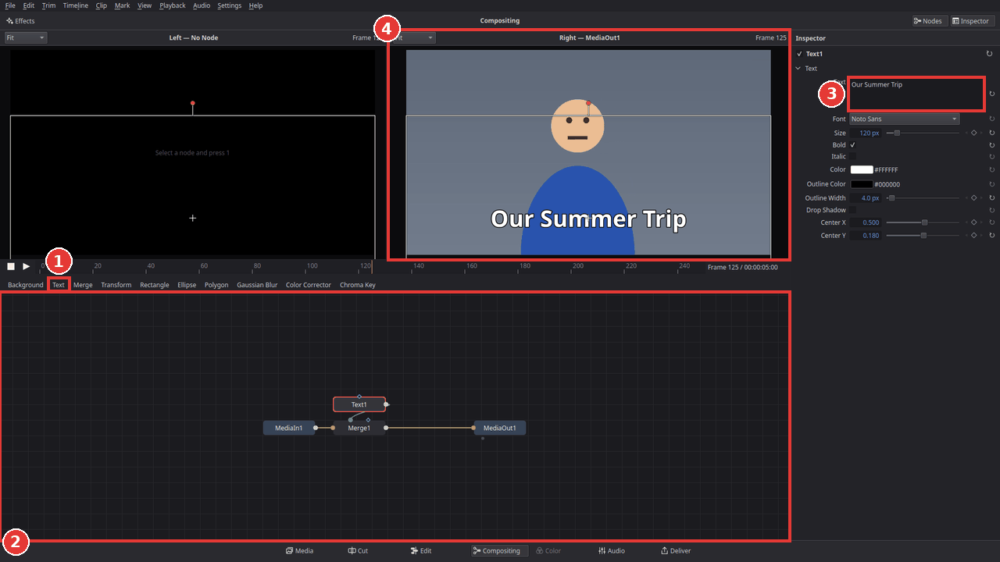

# Put text over a clip on the Compositing page

The **Compositing** page (new in Kinoklip 1.0.0 Beta) builds the picture of one clip from
**nodes**: small boxes that each do one thing (show the clip, write a text, blur, key out green,
combine two pictures) and that are joined by lines. It is the place for effects that need
several layers inside one clip. As a first step, you will put a text over a clip.

For a simple title over several clips, the Text title on the Edit page is quicker; see
[Getting started](getting-started.md#add-a-title).

## Open the clip on the Compositing page

1. On the Edit page, click the clip on the timeline.
2. Click **Compositing** in the page bar at the bottom of the window (**Shift+5**). You can
   also right-click the clip and choose **Open in Compositing Page**.

The page has:
- two **viewers** at the top; the right one shows the finished picture;
- the **node editor** at the bottom (2 in the picture below), with a row of buttons above it;
- the **Inspector** on the right, with the settings of the selected node.

At first the node editor shows two nodes joined by a line: **MediaIn1** (the clip's own picture)
and **MediaOut1** (what comes out of the clip). Nothing has changed yet.

## Add the text

1. Click **MediaOut1** in the node editor to select it.
2. Click **Text** in the row of buttons above the node editor (1). Kinoklip adds two nodes:
   **Text1**, which draws the text, and **Merge1**, which puts it over the clip's picture.

   

3. **Text1** is selected. In the Inspector, type your text into **Text** (3).
4. Change **Font**, **Size**, **Color**, **Outline Width** and **Drop Shadow** to taste.
5. To move the text, drag it in the right viewer (4), or change **Center X** and **Center Y**
   in the Inspector (0.5 and 0.5 is the middle of the picture).

Go back to the **Edit** page (**Shift+4**): the clip now shows the text there too, during
playback and in the export. A small node mark on the clip in the timeline shows that it has a
composition.

## Find your way around the node editor

- **Move** a node by dragging it. **Pan** with the middle mouse button (or hold **Space** and
  drag); **zoom** with the mouse wheel; **Ctrl+F** fits all nodes into view.
- **Show a node in a viewer:** select it and press **1** (left viewer) or **2** (right viewer).
  Handy to look at the text alone, or at the clip before the text.
- **Add other nodes:** the buttons above the node editor add the most common ones after the
  selected node (Background, Merge, Transform, masks, Blur, Color Corrector, Chroma Key).
  **Shift+Space** opens a list of every node with a search field.
- **Turn a node off** for a moment: select it and press **Ctrl+P**; press it again to turn it
  back on.
- **Delete** a node: select it and press **Delete**. **Ctrl+Z** undoes every step.

## Tips

- **Fade the text in:** select **Merge1** and keyframe its **Blend** (0 at the start, 1 a
  second later) with the diamond in the Inspector; see [Animate with keyframes](keyframe-animation.md).
- **Green screen in one clip:** select **MediaIn1** and click **Chroma Key**, then click
  **Background**. The new Merge puts the background in front of the keyed picture; select the
  Merge and press **Ctrl+T** to swap its inputs, so the background is behind. This does what
  [Remove a green screen](remove-a-green-screen.md) does with two tracks, inside one clip.
- **A logo picture:** the Compositing page cannot load a second picture file into a clip yet.
  Put the logo on a video track above the clip on the Edit page and make it small with
  **Zoom X**; see [Zoom, crop and picture-in-picture](zoom-crop-and-picture-in-picture.md).
- **Start over:** on the Edit page, select the clip and choose **Clip > Reset Composition**.

## If something goes wrong

- **The page says "Select a clip on the Edit page".** Go back to the Edit page, click a clip on
  a video track (or put the playhead over one) and switch to the Compositing page again.
- **The text does not show in the right viewer.** The right viewer must show **MediaOut1**
  (its name is in the viewer's title). Select **MediaOut1** and press **2**.
- **Keys like Delete or Ctrl+C do nothing.** Click into the node editor first; its keys only
  work while it has the focus.
