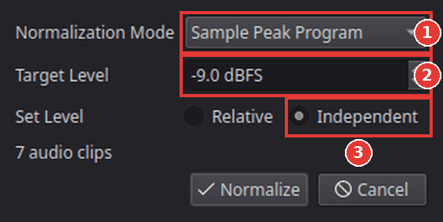

# Make quiet and loud clips the same volume

Clips recorded at different times or with different cameras often have very different
volumes: one person whispers, the next one shouts. Kinoklip can measure the clips and set
their volumes so they sound about equally loud.

## Normalize the clips

1. Select the clips on the timeline: click the first one and **Ctrl**-click the others, or drag
   a box around them with the **Selection** tool. Video clips with sound count too: their sound
   is used.
2. Choose **Clip > Normalize Audio Levels** (also in the right-click menu of a clip).

   

3. Choose the **Normalization Mode** (1). The window opens with **Sample Peak Program**;
   for even volumes switch to **ITU-R BS.1770-4**:
   - **ITU-R BS.1770-4** measures how loud the clip *sounds* (in LUFS). This is the best choice
     for making speech and music sound even. **-23 LUFS** is the broadcast standard; for
     videos on the internet **-14 LUFS** is common.
   - **Sample Peak Program** looks only at the loudest moment (in dBFS). Use it to make sure
     nothing is too loud, not to make clips sound alike.
   - **True Peak** is the same, measured more exactly (in dBTP).
4. Set the **Target Level** (2).
5. Under **Set Level** (3), choose:
   - **Independent**: every clip is set to the target on its own. Use this to even out the
     clips.
   - **Relative**: all clips change by the same amount, so the loudest one reaches the target
     and the differences between them stay.
6. Click **Normalize**. Kinoklip measures the sound of each clip (a bar shows the progress) and
   then changes their volumes. **Cancel** stops it without changing anything.

Play the clips to check. The new volume of each clip is in the **Audio** tab of the Inspector
(**Volume**) and on the level line of the audio clip; you can still adjust it by hand.
**Ctrl+Z** undoes the whole change in one step.

## Tips

- **Music under speech:** normalize the speech clips, then lower the music separately; see
  [Fade audio in and out, and add music](fade-audio-and-add-music.md).
- **Changing the volume by hand:** select a clip and set **Volume** in the **Audio** tab of the
  Inspector, or drag the level line on the audio clip up or down.
- The **Audio** page (**Shift+7**) has meters that show how loud the whole mix is while it
  plays.

## If something goes wrong

- **A message asks you to select audio clips.** Nothing with sound is selected. Click the
  clips on the timeline first.
- **A clip is still too quiet.** A clip with a very quiet recording may need more than the
  maximum volume. Check the **Volume** in the Inspector; if it is at its maximum (+24 dB), the
  recording itself is too quiet.
- **Background noise got louder.** Normalizing raises everything in a quiet clip, the noise
  too. Kinoklip has no noise reduction for sound yet.
