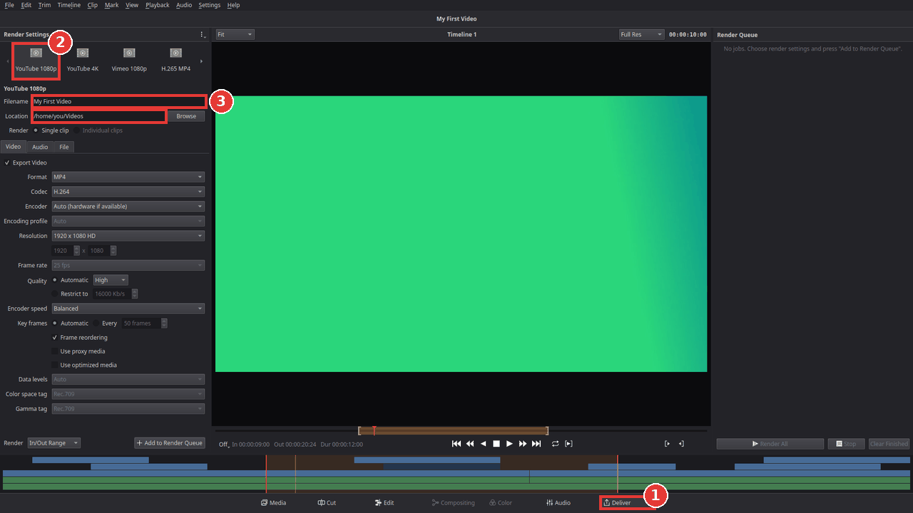
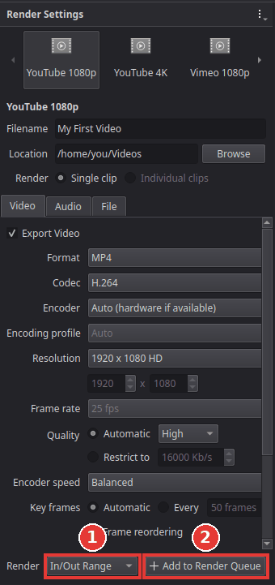
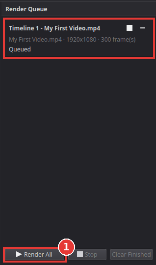

# Export a video for YouTube

You will turn your finished timeline into an MP4 file that YouTube accepts and plays in good
quality. Kinoklip does not upload the video for you: you upload the file on the YouTube website
afterwards.

## Steps

1. Save your project (**Ctrl+S**).
2. Click **Deliver** at the bottom of the window (1), or press **Shift+8**.

   

3. In **Render Settings** at the top left, click the **YouTube 1080p** preset (2). It sets
   everything YouTube needs: an MP4 file with H.264 video at 1920 x 1080 and AAC sound. If your
   footage is 4K, choose **YouTube 4K** instead (use the arrows next to the presets to see more).
4. Type a **Filename** (3), and next to **Location** click **Browse** to choose the folder for
   the file.
5. Near the bottom of Render Settings, next to **Render** (1 in the picture below), choose:
   - **Entire Timeline** to export everything, or
   - **In/Out Range** to export only the part between your in and out marks. You set those on
     the Edit page: move the playhead and press **I** for the start and **O** for the end.

   

6. Click **Add to Render Queue** (2). Your export appears as a job in the **Render Queue** on
   the right.
7. Click **Render All**.

   

8. Wait until the job says it is done. The bar shows how far it is and how long it still takes.
   Click the folder button on the job to open the folder with your video.
9. Upload the file on YouTube (on the YouTube website: **Create > Upload video**).

## Tips

- **You can keep working while it renders.** The job takes a copy of the timeline when you add
  it, so later changes do not end up in this export.
- **Hardware encoding** makes exports faster on many computers. **Encoder** on the Video tab is
  set to **Auto (hardware if available)**, so Kinoklip uses your graphics chip when it can.
- **Better quality or a smaller file:** on the **Video** tab, **Quality** sets how good the
  picture is. **High** is a good choice for YouTube; **Best** gives a bigger file.
- **Frame rate:** the video is exported at the frame rate of your timeline. To change it, use
  **File > Project Settings** (**Shift+9**) before you start editing.
- **Only the sound:** the **Audio MP3** or **Audio WAV** presets export just the audio.

## If something goes wrong

- **"Nothing to render: the timeline is empty."** Put some clips on the timeline first, on the
  Edit page.
- **"... already exists. Overwrite it when the job renders?"** A file with that name is already
  in the folder. Click **No** and change the **Filename**, or **Yes** to replace the old file.
- **The video is too short or too long.** Check **Render**: with **In/Out Range** only the
  marked part is exported. Choose **Entire Timeline** to export everything.
- **The export failed.** The job shows the reason. Often the folder cannot be written to, or
  the disk is full: choose another **Location** and add the job again. (If a hardware encoder
  fails, Kinoklip already switches to the normal software encoder by itself.)
