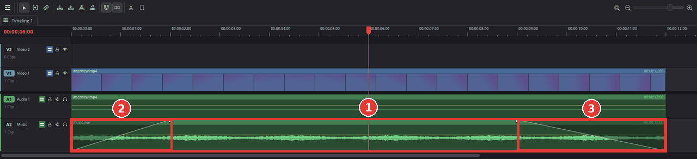
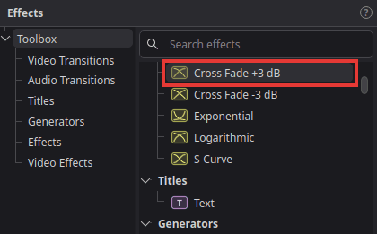

# Fade audio in and out, and add music

You will put background music under your video, make it quieter than the voices, and let it
fade in at the start and fade out at the end instead of starting and stopping abruptly.

## Add the music

1. Import the music file: **File > Import > Media** (**Ctrl+I**). MP3, WAV, FLAC, AAC and other
   common audio files work.
2. Drag the music from the media pool onto an empty audio track below your video's sound, for
   example **A2** (1 in the picture below). If there is no free audio track, choose
   **Timeline > Add Audio Track** first.
3. If the music is longer than your video, drag the right edge of the music clip to the left
   until it ends with the video. (Or move the playhead to the end of the video, select the music
   clip and press **Shift+]** to trim it there.)

## Fade in and fade out

1. Move the mouse over the music clip. Two small handles appear in its top corners.
2. Drag the **left** handle to the right: the music now fades in from silence (2). The further
   you drag, the longer the fade.
3. Drag the **right** handle to the left: the music fades out to silence at the end (3).

The shaded wedge shows the fade. Drag the handles again to change it, or all the way back to
remove it.

## Make the music quieter

The line across the music clip is its volume (the "level line").
- Drag the line down to make the whole clip quieter. Hold **Shift** for fine steps.
- Or select the clip and set **Volume** in the **Audio** tab of the Inspector. About -10 to
  -20 dB is often right for music under speech.

If you do not see the line, make the track taller: drag the bottom edge of the track header
(the area with the track name) downwards.

## Another way: audio transitions

1. Click **Effects** at the top left and open **Toolbox > Audio Transitions**.

   

2. Drag **Cross Fade +3 dB** onto the start or the end of an audio clip: it fades from or to
   silence there. Dropped on the cut between two audio clips, it blends one into the other.
3. Drag the edges of the transition on the timeline to make it longer or shorter.

The other audio transitions (**Cross Fade 0 dB**, **Cross Fade -3 dB**, **Exponential**,
**Logarithmic**, **S-Curve**) fade with a different curve; the picture on each shows its shape.
**Cross Fade +3 dB** is the one that sounds even for most music.

## Tips

- **Music quieter only while someone speaks:** **Alt**-click the level line to add a point
  (a "keyframe") there. Add four points around the speech, then drag the two middle ones down.
  The volume now dips smoothly under the voice and comes back afterwards.
- **Fade the picture too:** video clips have the same fade handles. Dragging them fades the
  picture from or to black, which is a common way to start and end a video; see
  [Fade to or from black](fade-to-black.md).
- **Clips at very different volumes:** select them and choose **Clip > Normalize Audio Levels**
  to bring them to the same level; see
  [Make quiet and loud clips the same volume](even-out-clip-volumes.md).

## If something goes wrong

- **No handles appear.** Make sure the mouse is over the clip itself and the **Selection** tool
  is active (press **A**).
- **The music drowns out the voices.** Lower the music's volume further (see above); -20 dB or
  less is fine for quiet background music.
- **You hear the music but not the video's own sound, or the other way round.** Check the
  track headers: the mute button (loudspeaker) and the solo button (headphones) must be off for
  the tracks you want to hear.
