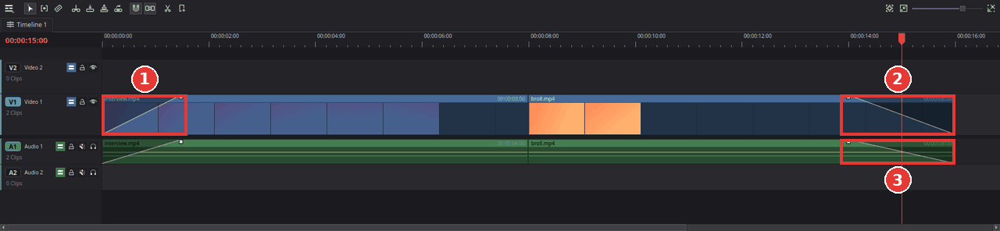
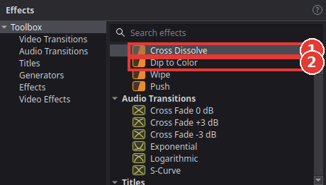

# Fade to or from black

You will let your video start from a black screen and end by fading to black, instead of
starting and stopping with a hard cut. This is the classic opening and ending of a video.

There are two ways. **Fade handles** are the quickest; a **transition** at the start or end of a
clip does the same and also fades the sound.

## With the fade handles

1. Move the mouse over the first clip on the timeline. Two small handles appear in its top
   corners.
2. Drag the **left** handle to the right. The picture now fades in from black (1). The further
   you drag, the longer the fade; a shaded wedge shows it.
3. Move the mouse over the last clip and drag its **right** handle to the left. The picture now
   fades out to black (2).

   

4. The handles on a video clip fade only the picture. The clip's sound on the audio track below
   has handles of its own: drag them the same way (3) so the sound fades along with the
   picture.
5. Press **Home** and then **Space** to watch the result.

To change a fade, drag its handle again; drag it all the way back to the corner to remove it.

## With a transition

A transition at the start or end of a clip, where there is no other clip to blend with, fades
from or to black. It fades the clip's sound as well.

1. Click **Effects** at the top left and open **Toolbox > Video Transitions**.

   

2. Drag **Cross Dissolve** (1) onto the end of the last clip (or the start of the first one).
3. Drag the outer edge of the transition on the timeline to make the fade longer or shorter.

**Dip to Color** (2) is for the middle of a video: dropped on the cut between two clips, it
fades the first clip to black and the second one up from black. Click the transition and pick
another **Color** in the Inspector to dip to white or any other colour.

## Tips

- **Fade a title in and out:** title clips have the same fade handles.
- **The fade shows the clip below instead of black.** A fade makes the clip transparent, so
  whatever is on the track below shows through. Black appears only where nothing is below.
  That is also a quick way to blend between two layers.
- **One second is a good start.** At 25 frames per second that is 25 frames; most endings use
  one to three seconds.

## If something goes wrong

- **No handles appear.** Make sure the **Selection** tool is active (press **A**) and the
  mouse is over the top part of the clip. On a very short clip, zoom in on the timeline first
  (**Ctrl+=**) so the clip is wide enough for the handles.
- **The picture fades but the sound stops abruptly.** Fade the audio clip too (step 4), or use
  a transition, which fades both.
