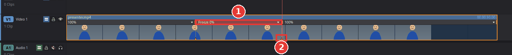

# Freeze a frame

You will stop the picture on one frame for a moment and then let the clip play on, for
example to hold a funny face or to point something out. You can also turn a whole clip into one
still frame.

## Hold a frame for a moment inside a clip

1. Click the clip on the timeline to select it.
2. Move the playhead to the frame you want to hold. The **Left** and **Right** arrow keys move
   one frame at a time.
3. Choose **Clip > Retime Controls** (**Ctrl+R**). A speed bar appears along the top of the
   clip, showing **100%**.
4. Click the small arrow in the speed bar and choose **Freeze Frame**. Kinoklip inserts a
   one-second freeze at the playhead, marked **Freeze 0%** (1). The clip gets one second longer
   and the clips after it move to the right; after the freeze the clip plays on from the same
   frame.

   

5. To hold the frame longer or shorter, drag the small handle at the **bottom** of the line at
   the end of the freeze (2) to the right or to the left.
6. Press **Ctrl+R** again to hide the retime controls.

The frozen part is silent. To remove the freeze, click the arrow in the freeze part and choose
**Reset Clip** (this also removes any other speed changes of the clip), or press **Ctrl+Z**
right after adding it.

## Turn a whole clip into a still

1. Select the clip.
2. Move the playhead to the frame you want to see.
3. Choose **Clip > Freeze Frame** (**Shift+R**).

The clip keeps its length but shows only that one frame. If the playhead is not over the clip,
it shows its first frame. Undo with **Ctrl+Z**.

A common way to use this: cut a clip at the playhead (**Ctrl+\\**), cut it again a few
seconds later, select the middle part and press **Shift+R**. The middle part now shows the
frame where it starts.

## Tips

- **Zoom in or add a title on the freeze** for emphasis: cut the freeze into its own clip as
  above, then see [Zoom, crop and picture-in-picture](zoom-crop-and-picture-in-picture.md) and
  the [title section of Getting started](getting-started.md#add-a-title).
- **Sound during the freeze:** the frozen part has no sound. Put music or a sound effect on
  another audio track under it.
- More about speed changes: [Speed up or slow down a clip](change-clip-speed.md).

## If something goes wrong

- **Freeze Frame is greyed out in the speed menu.** The playhead must be over the clip. Click
  in the ruler above the clip first.
- **Everything after the clip moved.** That is normal for a freeze inside a clip: the video gets
  longer by the length of the freeze. Use **Shift+R** on a cut-out part instead if the length
  must not change.
