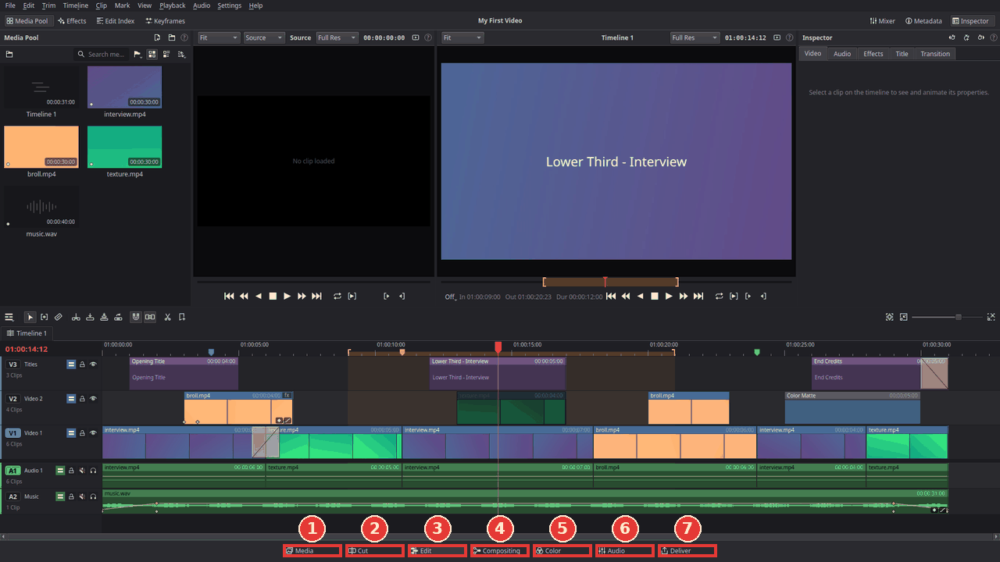
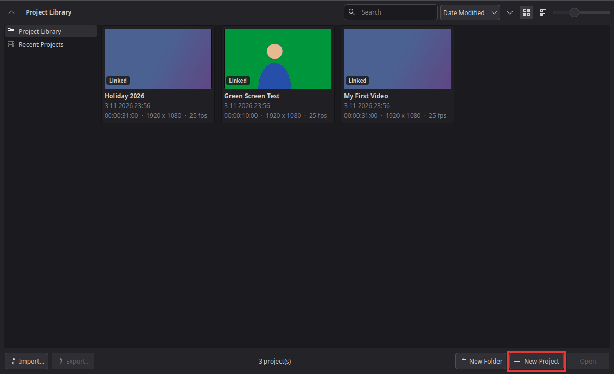
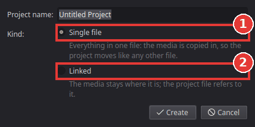
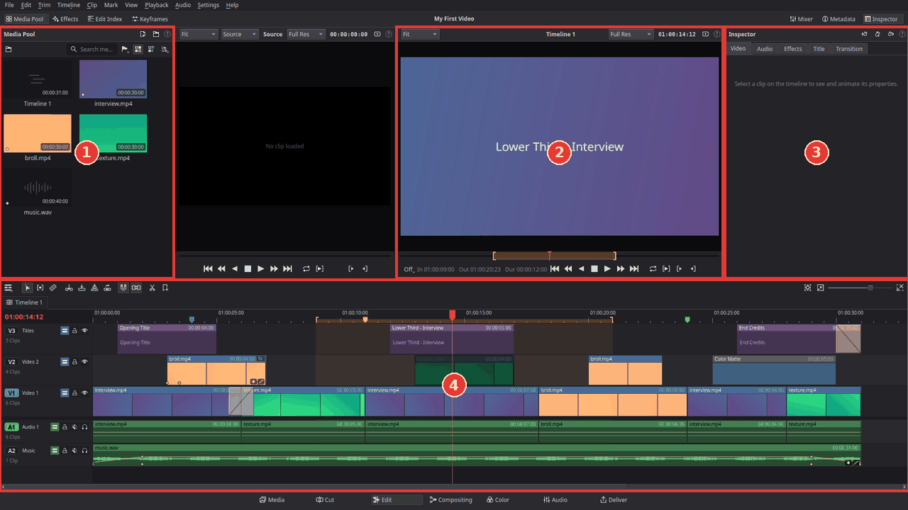
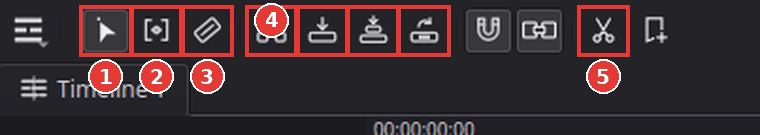
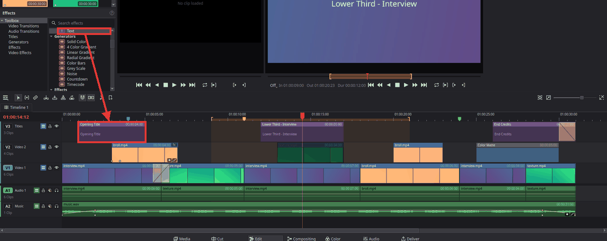
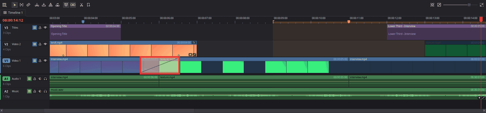
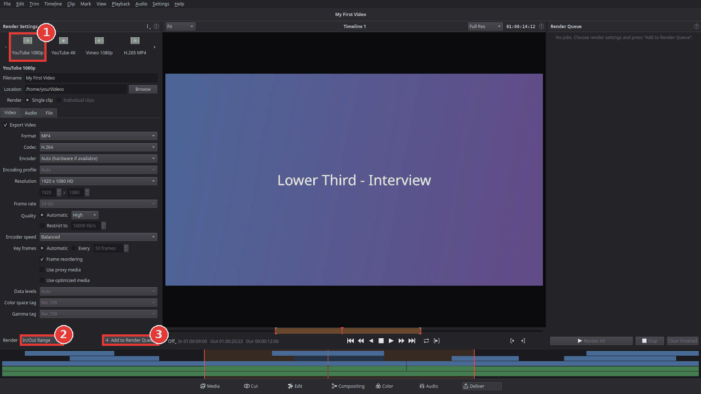
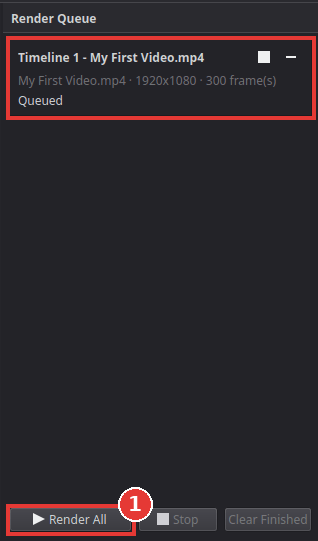

# Getting started

This page walks you through your first video: you make a project, bring in your clips, put
them on the timeline, cut them, add a title and a transition, and export the result. It takes
about fifteen minutes.

**Words you will meet:**
- **Clip**: one piece of video, sound or a picture.
- **Timeline**: the long strip at the bottom where your clips sit one after the other. Time runs
  from left to right.
- **Track**: one row of the timeline. Video tracks are called V1, V2, ... and audio tracks A1,
  A2, ... A clip on a higher video track covers the tracks below it.
- **Playhead**: the red line on the timeline that shows which moment you are looking at.

## The pages

Kinoklip is split into pages, one for each stage of the work. The buttons for the pages are
along the bottom of the window.

1. **Media**: look through your files and bring them into the project.
2. **Cut**: a quick, simple editor for fast rough cuts.
3. **Edit**: the main editor, where you will spend most of your time. This guide uses it.
4. **Compositing**: build the picture of one clip from nodes, for effects with several
   layers; see [Put text over a clip on the Compositing page](compositing-page.md).
5. **Color**: correct and grade the colours of your clips; see
   [Colour correct a clip](colour-correct-a-clip.md).
6. **Audio**: mix the sound: track levels, meters, equaliser and dynamics.
7. **Deliver**: export the finished video to a file.

While you drag files or clips, you do not have to let go to change page. Hold the drag over a
page button: the button lights up and fills from left to right, and after about a second the
page opens. Move away before it is full and nothing happens.

You can also switch pages with the keyboard: **Shift+2** (Media) up to **Shift+8** (Deliver);
**Shift+4** is the Edit page.

## Choose a menu layout

The menus at the top of the window come in two arrangements. **Resolve** (the default) has the menus of DaVinci Resolve, so a Resolve user finds everything where they expect it. **Streamlined** has shorter menus, none more than 12 lines long, grouped by task and with plain names, and one extra menu for the page you are on (Cut, Nodes or Grade, shown only on the Cut, Compositing and Color pages). Right-click menus on the timeline and in the Media Pool are shorter too, and show only what applies. The commands and their keys are the same in both.

To switch, open **Kinoklip > Preferences > UI Settings** and choose **Menu layout**. The menus change at once.

## Make a project

A project holds your timeline and the list of clips you use. When Kinoklip starts, it shows the
**Project Manager** with all your projects. You can open it again any time with
**File > Project Manager** (**Shift+1**).

1. Click **New Project**.
2. Type a name.
3. Choose the kind of project:

   

   1. **Single file**: everything, your clips included, is copied into one project file. Easy to
      move or back up, but it takes more disk space.
   2. **Linked**: the project only points to your clips where they already are. Smaller, but do
      not move or rename the clips afterwards.

   Lost the original of a clip in a single-file project? Right-click it in the Media Pool and
   choose **Save a Copy to Computer…**; the file is written out exactly as you imported it.
4. Click **Create**. The project opens on the Edit page.

Save your work often with **File > Save Project** (**Ctrl+S**).

## The Edit page

1. **Media pool**: the clips of your project.
2. **Viewer**: shows the picture under the playhead.
3. **Inspector**: the settings of the selected clip (size, position, volume, effects, ...).
4. **Timeline**: your edit.

The buttons at the top of the window show or hide panels: **Media Pool**, **Effects**,
**Inspector** and more.

## Import your clips

Do one of these:
- Choose **File > Import > Media** (**Ctrl+I**) and pick your video, audio and picture files.
- Or drag the files from your file manager into the media pool.
- Or copy the files (or a picture, such as a screenshot) anywhere, click in the media pool and press **Ctrl+V**. A pasted picture is saved as a PNG in a **Pasted Media** folder next to your project (or in Kinoklip's data folder if the project is not saved yet).

Your clips now appear in the media pool. Kinoklip reads common camera and phone formats (MP4,
MOV, MKV, H.264, H.265, ...), audio files and pictures.

To look through a clip without opening it, move the pointer across its thumbnail (or film
strip) in the media pool: the viewer shows the frame at that place, the left edge being the
first frame and the right edge the end of the clip, and goes back to what it showed when the
pointer leaves. A picture shows itself. Nothing changes while the viewer plays. Turn this
**Live Media Preview** off in the media pool's **…** menu.

If your clips were filmed at another frame rate than the project (for example 25 or 30 frames
per second, where a new project uses 24), Kinoklip asks whether to change the project frame
rate. Click **Change**, so your video plays as smoothly as it was filmed.

## Put clips on the timeline

The easiest way: **drag a clip from the media pool onto the timeline**. It lands where you drop
it, with its picture on a video track and its sound on an audio track below. Hold **Ctrl**
while you drop to push the other clips aside instead of covering them.

You can also drag files straight from your file manager onto the timeline. While you drag, an
outline shows where each clip lands and how long it is; when you drop, Kinoklip imports the
files into the media pool and puts the clips there.

To use only part of a clip:
1. Double-click the clip in the media pool. It opens in the source viewer.
2. Play to where the part should start and press **I** (mark in).
3. Play to where it should end and press **O** (mark out).
4. Press one of the edit buttons above the timeline (4 in the picture):

   

   - **Insert** (**F9**): puts the part at the playhead and moves the later clips to the right.
   - **Overwrite** (**F10**): puts the part at the playhead, covering what is there.
   - **Place on Top** (**F12**): puts the part on the first free track above.
   - **Replace** (**F11**): swaps the clip under the playhead for this one.

   Or press **Shift+F12** (**Edit > Append at End**) to add it after the last clip.

## Play your edit

Click in the timeline, then:
- **Space**: play and stop.
- **L**: play forward; press it again to play faster.
- **J**: play backwards; press it again to go faster.
- **K**: stop.
- **Left** / **Right** arrow: one frame back or forward.
- **Up** / **Down** arrow: jump to the previous or next cut.
- **Home** / **End**: jump to the start or the end.

You can also click or drag in the ruler above the tracks to move the playhead.

## Cut, trim and delete

The tools on the left of the timeline tool bar (see the picture above):

- **Selection** (1, **A**): click clips to select them, drag them to move them.
- **Trim** (2, **T**): drag the edge of a clip to make it shorter or longer; the clips after it
  move along, so no gap appears. The other tracks follow so picture and sound stay in sync (as
  long as the track's **Sync Lock** button in the track header, right of the lock, is on and
  the track is not locked): making the clip longer cuts a clip that spans the edit point and
  opens a gap of the same length; making it shorter removes the same frames from those tracks.
  Turn **Sync Lock** off, or lock the track, for a track that must stay where it is. To have new
  tracks start with Sync Lock off, untick **Sync Lock on new tracks** in Preferences > Editing;
  existing tracks keep their setting.
  **Auto Select** only decides which tracks cuts and other edits at the playhead reach.
  **Ctrl+Shift+[** and **Ctrl+Shift+]** trim to the playhead
  the same way.
- **Blade** (3, **B**): click a clip to cut it in two at that spot. Press **A** to go back to
  the selection tool.
- **Split Clip at Playhead** (5, **Ctrl+\\**): cuts the clips under the playhead in two (only
  the selected ones, if you selected any). Also in the **Timeline** menu.

**To trim** with the selection tool, drag the left or right edge of a clip. This leaves a gap
where the clip got shorter. **Shift+[** and **Shift+]** trim the start or the end of the clip
under the playhead to the playhead.

**To delete**, select a clip and press:
- **Backspace**: removes the clip and leaves a gap.
- **Delete**: removes the clip and closes the gap (a "ripple delete": everything after it moves
  left).

To remove a gap, click the empty space between two clips and press **Delete**.

Made a mistake? **Ctrl+Z** undoes, **Ctrl+Shift+Z** redoes.

## Add a title

1. Click **Effects** at the top left to open the effects library.
2. In **Toolbox > Titles**, pick a title:
   - **Text**: a plain line of text in the middle of the picture.
   - **Left Lower Third**, **Middle Lower Third**, **Right Lower Third**: a name and a role low
     in the picture, on a dark box, as used to introduce someone.
   - **Scroll**: rolling credits that move up through the picture over the length of the clip.
   - **Text Box**: a text on a plain background box.
   Rest the pointer on a title to see it over the picture in the timeline viewer first
   (**Live Preview**; it works for effects and transitions too, and moving along the name
   plays the title or transition through). Turn it off in the effects library's **…** menu.
3. Drag the title onto an empty video track above your clips, where it should appear (or
   double-click it to add it at the playhead). It becomes a five-second title clip.

   

4. Select the title clip: the Inspector opens on its **Title** tab. Type your text there (press
   **Enter** for a new line). There you can also change the font, size, colour, outline and
   background box, and move the text with **Position X** and **Position Y** (0.5 is the
   middle). **Anchor** says which side of the text stays at Position X, so a left lower third
   grows to the right. Tick **Scroll** to make any title roll up like credits; a longer clip
   scrolls more slowly.

Drag the edges of the title clip to make it show for a shorter or longer time.

## Add a transition

A transition blends one clip into the next instead of a hard cut.

1. Click the cut between two clips on the timeline (the line where they touch).
2. Press **Ctrl+T** (**Timeline > Add Default Transition**). A one-second **Cross Dissolve**
   appears on the cut.

   

3. To make it longer or shorter, drag its left or right edge.

Other transitions (dissolves, irises, shapes, wipes, motion and **Smooth Cut**) are in the
effects library under **Toolbox > Video Transitions**: drag one onto a cut. The
[transitions guide](transitions.md) lists them. To remove a transition, click it and press
**Delete**.

## Export your video

1. Click **Deliver** at the bottom of the window (**Shift+8**).

   

2. Click a preset at the top left, for example **YouTube 1080p** (1).
3. Enter a **Filename** and choose a **Location** (the folder) for the file.
4. Next to **Render** (2), choose **Entire Timeline**, or **In/Out Range** to export only the
   part between the in and out marks you set on the timeline with **I** and **O**.
5. Click **Add to Render Queue** (3). The job appears in the render queue on the right.
6. Click **Render All**.

   

The bar on the job shows how far it is. When it is done, the folder button on the job opens the
folder with your new video. You can keep editing while it renders.

## Next steps

- [Export a video for YouTube](export-for-youtube.md)
- [Remove a green screen](remove-a-green-screen.md)
- [Speed up or slow down a clip](change-clip-speed.md)
- [Fade audio in and out, and add music](fade-audio-and-add-music.md)
- [Colour correct a clip](colour-correct-a-clip.md)

## Something went wrong?

Choose **Help > Report a Bug or Inconsistency...**. Pick whether it is a bug, something that works
differently from DaVinci Resolve, or an idea. The window shows exactly what it would add to your
report (versions and settings, nothing personal) and opens GitHub's report form in your browser,
with or without that text. Write what you did, what happened and what you expected, and submit it
there. You need a free GitHub account. Kinoklip itself never sends anything; see
[Privacy](../privacy.md). For a crash or a playback problem, also attach the log file from
**Help > Export Log File...** ([how](send-a-log-file-with-a-bug-report.md)).

Have a question, or want to show what you made? Choose **Help > Join the Community on Discord**
to open the invite to the Kinoklip server in your browser.
