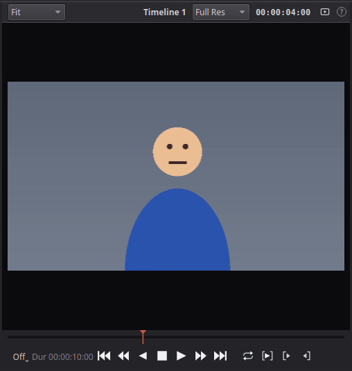
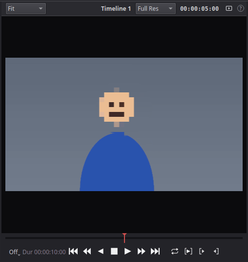
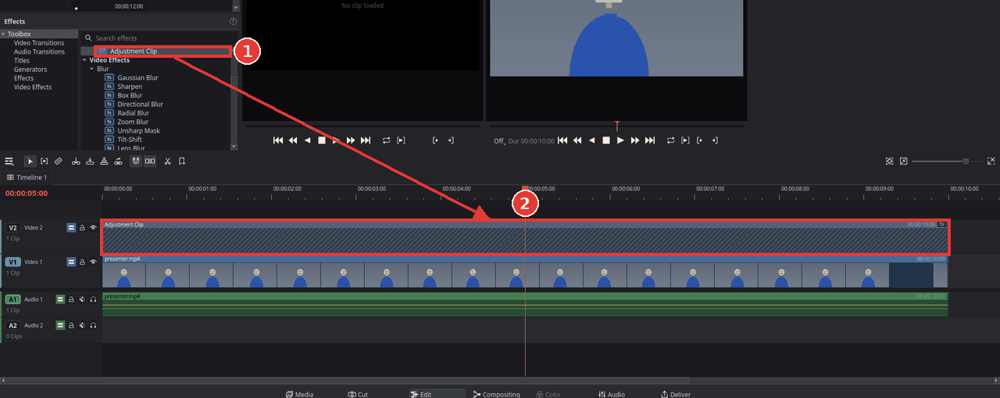
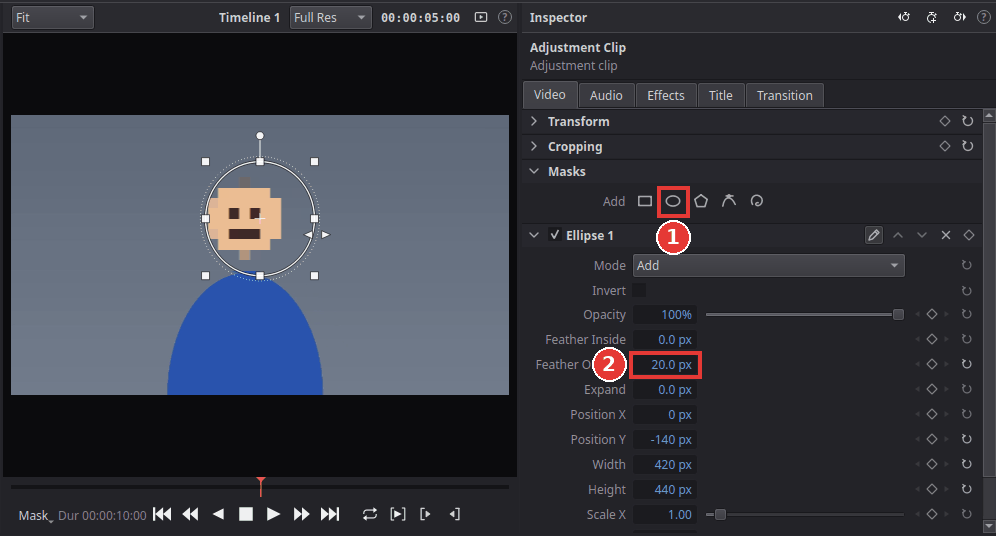

# Blur or hide part of the picture

You will hide a face, a number plate, a screen or a logo by blurring or pixelating just that
area, while the rest of the picture stays sharp.

The idea: an **adjustment clip** on the track above your clip carries the effect (a blur or a
mosaic), and a **mask** limits the effect to the area you want to hide.

| Before | After |
|---|---|
|  |  |

## 1. Add an adjustment clip over the clip

1. Click **Effects** at the top left and open **Toolbox > Effects**.
2. Drag **Adjustment Clip** (1) onto the empty video track above your clip (**V2**), at the
   time where the area must be hidden (2).

   

3. Drag the edges of the adjustment clip so it starts and ends where the area must be hidden
   (for example the whole length of the clip below).

An adjustment clip has no picture of its own: its effects act on everything on the tracks
below it.

## 2. Add the blur

1. In the effects library, open **Video Effects > Stylize** and drag **Mosaic** onto the
   adjustment clip. (For a soft blur instead, use **Video Effects > Blur > Gaussian Blur**.)
2. The whole picture is now pixelated. Click the adjustment clip, open the **Effects** tab of
   the Inspector and make the blocks bigger with **Block Size** (or raise **Radius** for the
   Gaussian Blur) until the face can no longer be recognised.

## 3. Limit it to one area with a mask

1. With the adjustment clip selected, open the **Video** tab of the Inspector.
2. Under **Masks**, click the ellipse button (1) (or choose **Clip > Add Mask > Ellipse Mask**).
   An ellipse appears in the viewer, and the effect now shows only inside it.

   

3. In the viewer, drag inside the ellipse to move it over the face, and drag the small squares
   on its edge to change its size.
4. For a soft edge, raise **Feather Outside** (2) a little, for example to 20 px.
5. Play the clip (**Space**) to check that the area stays hidden in every frame.

## If the area moves

Kinoklip cannot follow a moving object by itself yet (no tracking). For an object that moves,
animate the mask: move the playhead to the start, click the diamond in the title of the mask's
section in the Inspector to add a keyframe, then go forward a little (for example half a
second), move the ellipse onto the object again, and repeat. Kinoklip moves the mask smoothly
between those keyframes. See [Animate with keyframes](keyframe-animation.md).

If the area hardly moves, simply make the ellipse a little bigger so it covers the whole path.

## Tips

- **Black bar instead of a blur:** use a **Rectangle Mask** with a **Solid Color** clip from
  **Toolbox > Generators** instead of the adjustment clip.
- **Several areas:** add one mask per area to the same adjustment clip.
- **Hide everything except one area:** tick **Invert** in the mask's settings; then the blur
  is outside the ellipse.
- **On-screen controls gone?** Click the button at the bottom left of the viewer and choose
  **On-Screen Mask Controls**, or click the pencil button in the mask's section of the
  Inspector.

## If something goes wrong

- **Nothing is blurred.** The adjustment clip must be on a track *above* the clip and at the
  same time on the timeline, and the effect must be on the adjustment clip (check its
  **Effects** tab).
- **The whole picture is blurred.** The adjustment clip has no mask yet, or the mask is
  switched off: check the tick box in the title of the mask's section.
