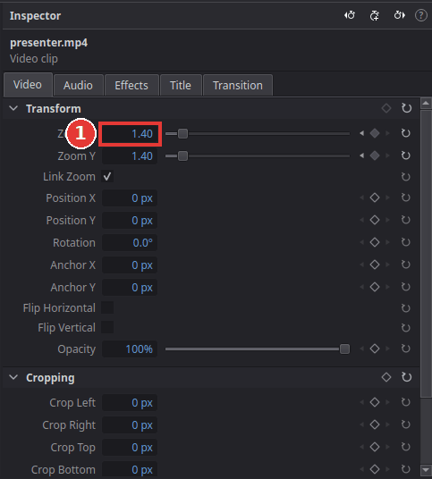
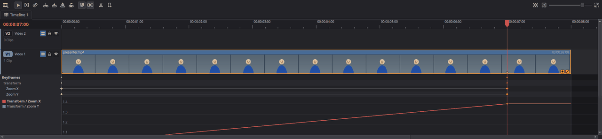

# Animate with keyframes

You will make something change over time: a slow zoom into a picture, a title that slides in,
a clip that fades to half transparent. You do this with **keyframes**: you set a value at one
moment and another value at a later moment, and Kinoklip moves smoothly between them.

As an example, here is a slow zoom in over a clip, often used to bring life into a still
picture or a long interview shot.

## A slow zoom in

1. Click the clip on the timeline and open the **Video** tab of the **Inspector**.
2. Move the playhead to where the zoom should start, for example the first frame of the clip.
3. Click the small diamond at the right end of the **Zoom X** row (1). It turns filled: there is
   now a keyframe here with the current zoom (1.00).
4. Move the playhead to where the zoom should end, for example near the end of the clip.
5. Change **Zoom X** to **1.40** (type it, or drag left and right on the number). Because the
   value is now animated, Kinoklip adds a second keyframe here by itself. **Link Zoom** is ticked,
   so **Zoom Y** follows.

   

6. Press **Home** and **Space**: the picture now zooms in slowly between the two keyframes.

The same works for every row that has a diamond: **Position X** / **Position Y** to move a clip
or a title across the picture, **Rotation**, **Opacity** to fade, **Crop** values, effect
settings, the volume on the **Audio** tab, and so on.

## Find, change and remove keyframes

- The small arrows next to the diamond jump to the previous and next keyframe of that row.
  **[** and **]** (**Clip > Previous Keyframe** / **Next Keyframe**) jump across all of them.
- To change a keyframe, jump to it (the diamond is filled) and change the value.
- To remove a keyframe, jump to it and click the filled diamond.
- The diamond in the title of a section (for example **Transform**) adds or removes keyframes
  for every row of that section at once.

## Smooth starts and stops

By default the value changes at an even speed from one keyframe to the next, which can look
mechanical. Right-click a filled diamond and choose **Ease In and Out**: the movement then
starts slowly, speeds up and slows down again before it stops.

To make every new keyframe start that way, right-click a diamond (or a keyframe in the
Keyframes panel) and choose **Set as Default for New Keyframes**, or pick it in
**Preferences > Editing > New keyframes**. Keyframes you already made stay as they are.

## See all keyframes on the timeline

Every animated clip shows two small buttons at its bottom-right corner on the timeline. The
keyframe button opens a lane under the clip with a mark for each keyframe; drag the marks to
move keyframes in time. The curve button shows how the value changes between them.

## Tips

- **Ken Burns effect:** combine a slow zoom with a slow change of **Position X**, so the
  picture drifts while it zooms.
- **Move a title in from the side:** keyframe its **Position X** off the screen at its start and
  at its final place a second later.
- **Alt+K** (**Clip > Add Keyframe**) adds or removes a keyframe on the row you changed last.
- Keyframes belong to the clip: when you move the clip on the timeline, its animation moves
  with it.

## If something goes wrong

- **The diamond is greyed out.** The playhead is not over the selected clip. Move it into the
  clip first.
- **Changing a value changes it for the whole clip.** The row has no keyframes yet. Click its
  diamond first.
