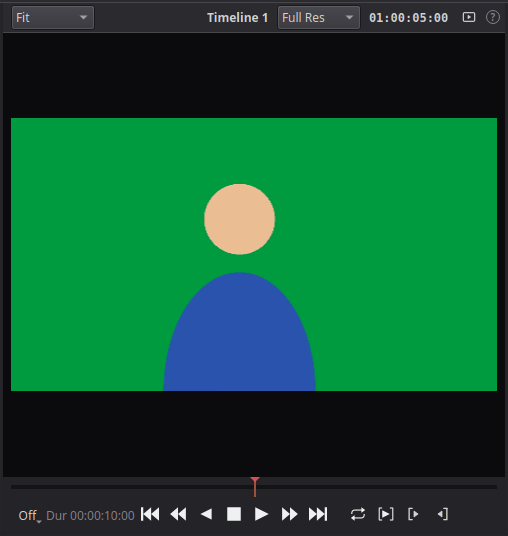
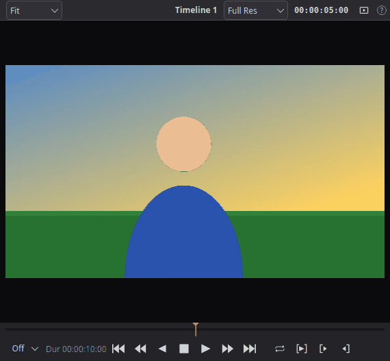
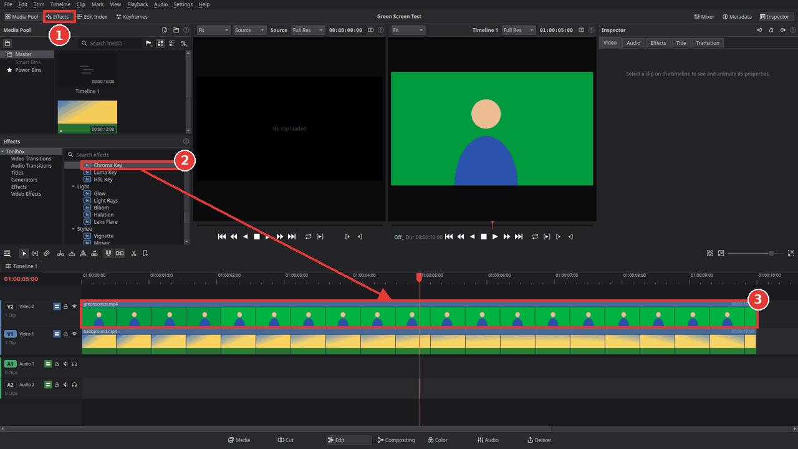
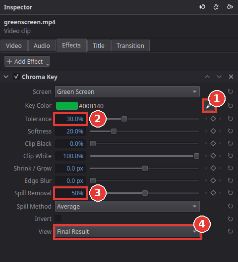
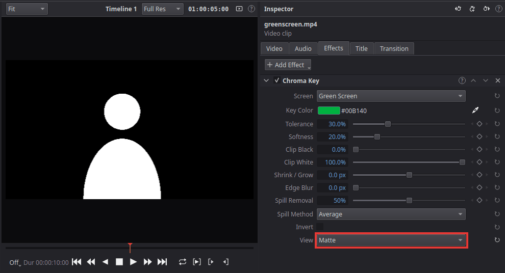

# Remove a green screen

You will make the green background of a clip transparent, so the person in front of it appears
over another picture. The same steps work for a blue screen. This is called **keying**: the
green colour is the "key" that is cut out.

| Before | After |
|---|---|
|  |  |

## What you need

- A clip filmed in front of a green (or blue) screen.
- A background: another video or a picture. Put the background on track **V1** and the green
  screen clip on **V2**, right above it. The key makes holes in the upper clip, and the lower
  one shows through.

## Steps

1. Click **Effects** at the top left (1) to open the effects library.
2. In the list, open **Video Effects > Key** and find **Chroma Key** (2). You can also type
   "chroma" in the search field.
3. Drag **Chroma Key** onto the green screen clip on the timeline (3).

   

   The green should mostly disappear right away: **Screen** is set to **Green Screen**. For a
   blue screen, choose **Blue Screen** there.
4. Click the clip to select it. In the **Inspector** on the right, open the **Effects** tab. You
   see the settings of the Chroma Key.

   

5. Click the eyedropper next to **Key Color** (1), then click on the green background in the
   viewer. Kinoklip now removes exactly the green of your clip. Tip: drag a small rectangle
   instead of clicking, to use the average colour of an area. Press **Esc** to cancel.
6. Set **View** (4) to **Matte**. The viewer now shows what stays (white) and what becomes
   transparent (black).

   

7. Adjust until the background is fully black and the person fully white:
   - **Tolerance** (2): raise it if green is left over, lower it if parts of the person
     disappear.
   - **Softness**: makes the edge between the two softer.
   - **Clip Black** and **Clip White**: turn nearly black areas fully black and nearly white
     areas fully white. Useful for grey specks in the background or small holes in the person.
8. Set **View** back to **Final Result**.
9. If the edges of the person still look green, raise **Spill Removal** (3). It takes the green
   glow away that the screen reflects onto hair and skin.
10. Play the clip (**Space**) to check that the key holds in every frame.

## Tips

- **Light the screen evenly.** A screen without shadows and wrinkles keys much more cleanly than
  any setting can fix later.
- **Rough edges:** **Shrink / Grow** makes the kept area a little smaller (negative values) or
  bigger; **Edge Blur** softens the edge. Small values (1 to 2 px) are usually enough.
- **Parts of the room are in the picture** (lights, the edge of the screen): draw a mask around
  the person with **Clip > Add Mask** (for example **Rectangle Mask**). Everything outside the
  mask is removed, keyed or not. This is often called a "garbage matte".
- **Status view:** set **View** to **Status**. It shows solid areas in white, transparent areas
  in black and half-transparent areas in grey, which makes small holes easy to find.
- **Everything inside one clip:** on the [Compositing page](compositing-page.md) a **Chroma
  Key** node, a **Background** node and a **Merge** do the same as the two tracks here, inside
  the green screen clip itself. Useful when you want to add text or more layers to the keyed
  shot as well.
- **Other keys:** in the same **Key** folder, **Luma Key** removes dark or bright areas (for
  example a black background), and **HSL Key** removes a range of hue, saturation and
  brightness.

## If something goes wrong

- **The background turns black instead of showing the other clip.** The background clip must
  be on a track below the keyed clip (for example V1 under V2), at the same time on the
  timeline.
- **The eyedropper does nothing.** Move the playhead over the keyed clip first: the eyedropper
  only works while the viewer shows that clip.
- **Parts of the person disappear too** (for example a green shirt). Lower **Tolerance**, pick
  the colour again with the eyedropper, or wear a different colour next time.
