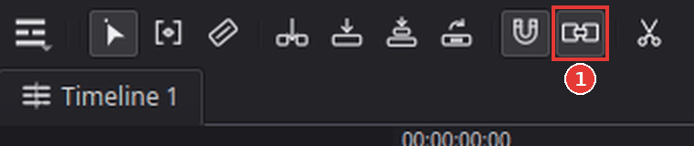
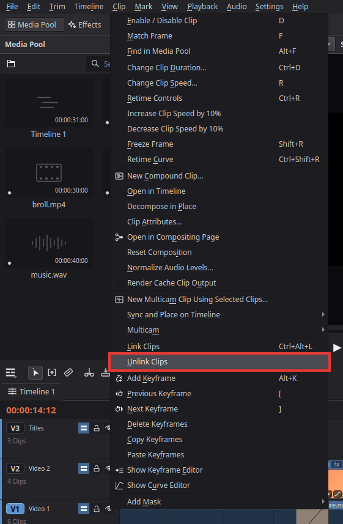

# Separate the audio from the video

When you put a clip with sound on the timeline, its picture lands on a video track and its
sound on an audio track below. The two parts are **linked**: click one and both are selected,
move one and the other moves along. That keeps them in sync, but sometimes you want to work on
only one of them: delete the sound and keep the picture, move the sound a little, or use the
sound under a different picture.

## Just once: Alt-click

Hold **Alt** and click the part you want (the video or the audio clip). Only that part is
selected. Now you can:
- press **Backspace** to delete only that part (for example the camera sound, when you will put
  music under the picture instead);
- drag it to move only that part.

The two parts stay linked for later.

## For a while: turn off Linked Selection

Click the **Linked Selection** button in the timeline tool bar (1) or press **Ctrl+Shift+L**
(**Timeline > Linked Selection**). While it is off, every click selects only the part you click.
Press it again to turn it back on.

## For good: unlink the clips

1. Click the clip on the timeline (picture and sound are both selected).
2. Choose **Clip > Unlink Clips**, or right-click the clip and choose **Unlink Clips**.

   

The picture and the sound are now two separate clips.

To join them again, select both (click one, **Ctrl**-click the other) and choose **Clip > Link
Clips** (**Ctrl+Alt+L**).

## Tips

- **Use only the sound of a video file** (or only its picture): put the clip on the timeline,
  **Alt**-click the part you do not want and press **Backspace**.
- **Only the picture or only the sound when editing with the edit buttons:** the track buttons
  **V1** and **A1** on the far left of the track headers (the "source patches") decide which
  parts Insert, Overwrite and the other edit buttons put on the timeline. Click one to turn it
  off.
- **Keep them in sync:** once the parts are unlinked, nothing keeps them together. Move them
  together by selecting both (click one, **Ctrl**-click the other) before you drag.

## If something goes wrong

- **Deleting the sound also deleted the picture.** The parts were still linked and both were
  selected. Undo (**Ctrl+Z**), then **Alt**-click only the audio clip and delete it.
- **After unlinking, the sound slipped out of sync.** Undo the move (**Ctrl+Z**), or link the
  parts again and move them together.
