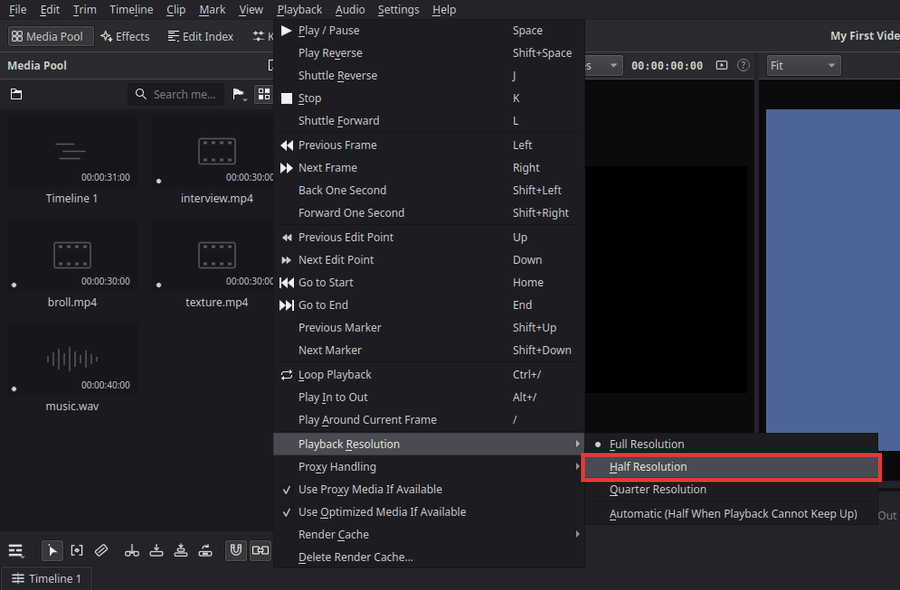
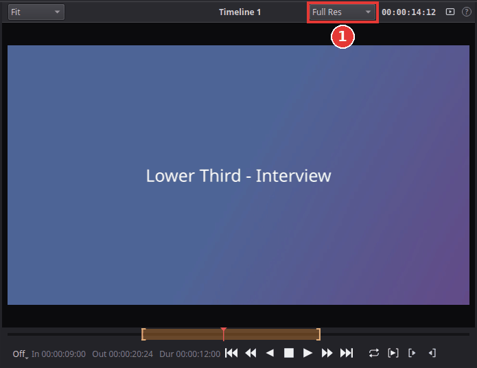

# Fix choppy playback

Playback stutters, skips frames or lags behind the sound? That usually means the computer
cannot decode and process the video fast enough. Phone and camera files (H.264, H.265, 4K,
HDR) are made to be small, not to be easy to play backwards and forwards in an editor, and
effects, titles and several video layers add more work.

Try these in order, from the quickest to the most thorough. None of them changes your exported
video: Kinoklip always exports from the original files at full quality.

## 1. Lower the playback resolution

Choose **Playback > Playback Resolution** and pick **Half Resolution** or **Quarter
Resolution**. The viewer shows a slightly softer picture, but the computer has far less to do.

**Automatic (Half When Playback Cannot Keep Up)** shows full resolution and switches to half
only while playback cannot keep up. The same choice is in the small menu at the top of the
viewer (**Full Res**, **Half Res**, ...) (1 in the picture below).

## 2. Make proxies of large files

A **proxy** is a smaller copy of a clip that is quick to decode. Kinoklip plays the proxy while
you edit and uses the original file for the export.

1. In the media pool, select the clips that play badly (**Ctrl**-click or **Shift**-click to
   select several).
2. Right-click one of them and choose **Generate Proxy Media**.
3. Kinoklip makes the proxies in the background, one file at a time; a small **P 42%** on each
   clip shows the progress, then **P** when it is ready. You can keep working meanwhile.

While a proxy is used, the viewer shows **Proxy** in its title bar. **Playback > Proxy
Handling** decides which files play:
- **Prefer Proxies** (the default): proxies where they exist.
- **Prefer Camera Originals**: the original files while they are available.
- **Disable All Proxies**: always the original files (to check fine detail).

**Generate Optimized Media** (in the same right-click menu) works the same way but makes a
full-size copy in an edit-friendly format: use it when you need full resolution while editing.
**Playback > Use Optimized Media If Available** turns its use on or off.

The proxy size and format are in **File > Project Settings** (**Shift+9**) under **Optimized
Media and Render Cache**. **Choose automatically** makes 1080p and 4K proxies 960 x 540, which
plays well on almost any computer.

## 3. Turn on the render cache

Proxies help with heavy files; the **render cache** helps with heavy *edits*: effects,
transitions, several video tracks on top of each other, speed changes.

1. Choose **Playback > Render Cache > Smart**.
2. Stop playback and wait a few seconds. Kinoklip renders the heavy parts of the timeline in
   the background and keeps them as ready-made pictures.

A thin line at the top of the timeline ruler shows the state: **red** where a part still needs
to be rendered, **blue** where it is ready. Blue parts play smoothly. When you change something
in a part, it turns red again and is rendered again.

- **User** instead of **Smart** caches only the clips you choose: select a clip and choose
  **Clip > Render Cache Clip Output**.
- **Playback > Delete Render Cache** frees the disk space again.

## Tips

- **Close other heavy programs** (browsers with many tabs, games) while editing.
- **Plug in the laptop.** On battery, many laptops slow down the processor and graphics.
- **Rendering on the Deliver page is not affected:** proxies, the cache and the playback
  resolution only change what you see while editing. The exported file is always made from the
  original files at full resolution.

## If something goes wrong

- **The viewer does not say Proxy although a proxy was made.** Check **Playback > Proxy
  Handling** (**Prefer Proxies**). If the clip shows **P!** in amber, the original file has
  changed since; generate the proxy again.
- **The red line at the top of the ruler never turns blue.** The cache renders only while you
  are not working: stop playback and leave the mouse and keyboard alone for a few seconds.
- **Proxies and caches fill the disk.** Delete them with **Delete Proxy Media** in the media
  pool's right-click menu and **Playback > Delete Render Cache**. The render cache folder is
  also kept below a size limit (20 GB by default, in **Preferences**).
