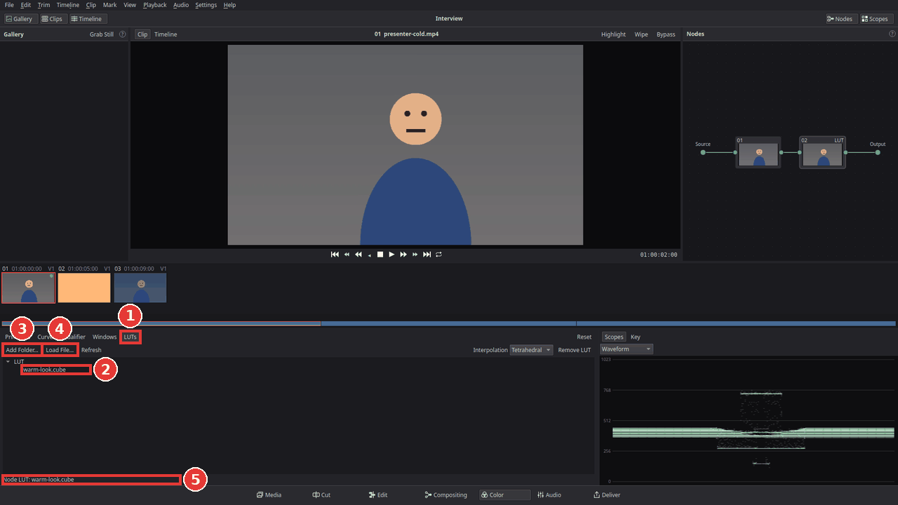

# Use a LUT

A **LUT** (look-up table) is a small file that turns every colour of a picture into another
one. There are two common kinds:

- **Camera LUTs** turn the flat, grey-looking "log" recordings of many cameras, drones and
  phones (S-Log, V-Log, D-Log, C-Log and so on) into normal-looking colours. The camera maker
  usually offers them as a free download for its log profile.
- **Creative LUTs** (also called "looks") give a picture a style: warmer, film-like, faded,
  teal and orange.

Kinoklip reads LUTs in the common **.cube** format (1D and 3D). **Kinoklip comes with no LUTs**:
use the ones from your camera's maker, ones you bought or made, or one of the many free LUT
packs on the internet (check that its licence lets you use it in your videos).

## Put your LUTs where Kinoklip finds them

The **LUTs** palette on the Color page lists the .cube files of your LUT folders. The first
folder is Kinoklip's own:

`~/.local/share/kinoklip/Kinoklip/LUT`

(`~` is your home folder; the `.local` folder is hidden, press **Ctrl+H** in the file manager
to see it). Copy your .cube files there, in subfolders if you like, or add the folder where they
already are:

1. Open the Color page (**Shift+6**) and click **LUTs** in the bar above the palettes (1 in
   the picture below).
2. Click **Add Folder…** (3) and choose the folder with your LUTs. Kinoklip remembers it.
3. Click **Refresh** after you have copied new files into a folder.

## Apply a LUT to a clip

1. Put the playhead over the clip, or click it in the clips strip.
2. In the Nodes panel, click the node that should get the LUT. On a clip without a grade there
   is no node yet; the LUT then makes node **01**.
3. In the LUTs palette, **double-click** the LUT (2). The viewer shows the clip with the LUT,
   and the line under the list says which LUT the node has (5). The node's tile shows **LUT**.

To use a .cube file that is not in one of the folders, click **Load File…** (4) and choose it.

To take the LUT away again, select the node and click **Remove LUT**.

## Where to put the LUT

A node applies its LUT after its own corrections (the wheels, Temp, curves). That matters:

- **A camera LUT** should see the picture as the camera recorded it. Put it in node **01** and
  make your corrections in a node after it (**Alt+S** adds one). If the log picture is too dark
  or too bright for the LUT, add a node *before* it (**Shift+S**, Add Serial Node Before) and
  fix the exposure there.
- **A creative LUT** usually goes last: correct the clip in node 01 (see
  [Colour correct a clip](colour-correct-a-clip.md)), press **Alt+S** and apply the look in
  node 02.

## Make the LUT weaker

Many looks are too strong at full strength. Select the node with the LUT, click **Primaries**
and lower **Mix** (at the bottom of the palette): 1 is the full LUT, 0.5 half way between the
picture before the node and the LUT's result. (Mix fades everything in that node, so keep the
LUT in a node of its own.)

## Give many clips the same LUT

Grade one clip, then copy its grade to the others with **Ctrl+C** and **Ctrl+V** in the clips
strip, a middle-click, or a gallery still; see
[Colour correct a clip](colour-correct-a-clip.md#give-other-clips-the-same-correction). For the
same look over the whole video, click **Timeline** above the viewer and apply the LUT to the
timeline's grade instead.

On the Edit page there is also the **Apply LUT** effect: in the effects library, open **Video
Effects > Color** and drag **Apply LUT** onto the clip, then choose the file under **LUT File**
in the Inspector and set its **Strength**. It works before the clip's Color page grade, so it
suits a camera LUT.

## Tips

- **Interpolation:** next to **Remove LUT**, **Tetrahedral** (the default) is the more exact
  way of reading a 3D LUT; **Trilinear** is the older one some LUTs were made for.
- **Keep the .cube files where they are.** The project remembers where each LUT file is but
  does not copy it. If you move, rename or delete the file, or open the project on another
  computer, the clip shows without the LUT until the file is back in the same place.

## If something goes wrong

- **The list says "(no .cube files)".** The folder has no files ending in .cube. Kinoklip reads
  only .cube; LUTs in other formats (.3dl, .look, .png "HALD" files) need to be converted
  first.
- **The list is greyed out.** The selected node is a mixer (a small **P** or **L** tile);
  click a numbered node first.
- **The picture looks far too contrasty and saturated.** That happens when a camera LUT goes
  on footage that was not recorded in that camera's log profile. Use the LUT only on the log
  clips it was made for, or choose a creative LUT instead.
