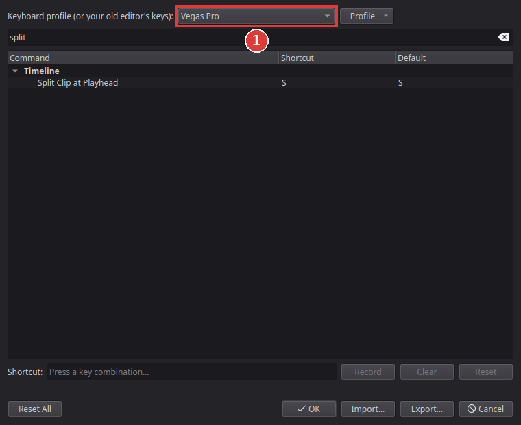

# Use the shortcuts of your old editor

Kinoklip's keys are [DaVinci Resolve](https://www.blackmagicdesign.com/products/davinciresolve)'s. If your fingers know another editor, you can switch all
of Kinoklip's keys to that editor's in one step: Vegas Pro (where **S** cuts the clip at the
playhead), [Premiere Pro](https://www.adobe.com/products/premiere.html), [Final Cut Pro](https://www.apple.com/final-cut-pro/), [Avid Media Composer](https://www.avid.com/media-composer), [Kdenlive](https://kdenlive.org) or [Shotcut](https://shotcut.org).

## The first time Kinoklip starts

The Project Manager shows a bar at the top: **Coming from another editor?** Pick your old
editor from the list and click **Use**. Click **No Thanks** to keep Resolve's keys. The bar
appears only once; you can change your choice at any time as shown below.

## Switch the keys at any time

1. Choose **Kinoklip > Keyboard Customization** (**Ctrl+Alt+K**).
2. Open the list at the top, **Keyboard profile**, and pick your old editor (1). The keys
   change at once, and the **Shortcut** column shows the new ones; type a command in the search
   field to find it.

   

3. Click **OK** to keep them, or **Cancel** to go back to the keys you had.

Final Cut Pro is a Mac program: its **Command** key is **Ctrl** here, **Option** is **Alt**,
and **Control** is the Windows (Super) key.

Not every command of the other editor exists in Kinoklip, and a few keys are best guesses. You
can change any key yourself: select the command, click **Record** and press the new key. Your
changes are kept with that profile, and **Reset** puts a single key back. Each preset's list of
keys, with how sure we are of each and what is missing, is in the
[keyboard preset pages](../keymaps/readme.md).

## Bring your own shortcut file

If you changed the keys in Premiere Pro or Final Cut Pro, Kinoklip can read that file:

1. In Keyboard Customization, click **Import...**.
2. Choose your Premiere Pro keyboard file (**.kys**) or your Final Cut Pro command set
   (**.commandset**).

Kinoklip makes a new profile from it, starting from that editor's preset. Below the list it
says how many shortcuts it took over and how many it skipped (commands Kinoklip does not have).
A Final Cut Pro command set saved in the binary format must be converted first, on the Mac:
`plutil -convert xml1 MyKeys.commandset`.
