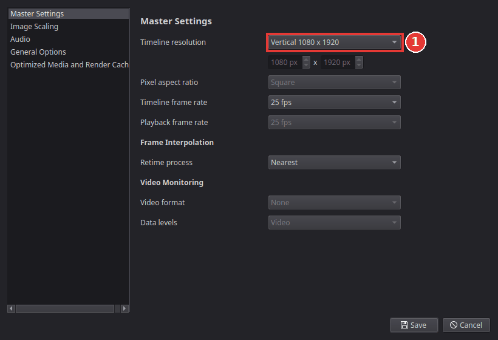
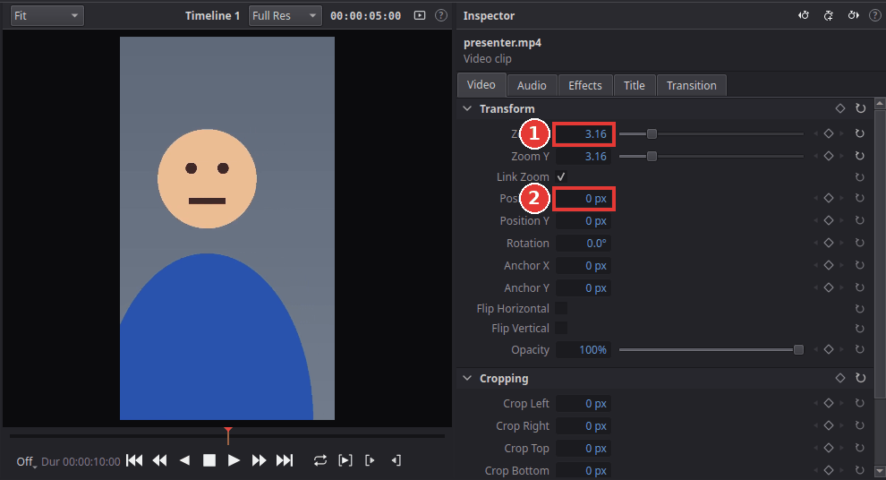
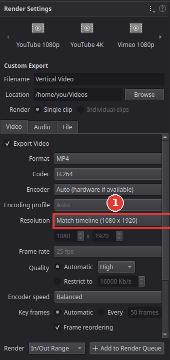

# Make a vertical video for Shorts, Reels and TikTok

You will make an upright video in the 9:16 format that YouTube Shorts, Instagram Reels and
TikTok use: 1080 pixels wide and 1920 pixels high. Two settings matter, and people often change
only one of them:

- the **timeline resolution**: the shape of the picture you edit in, and
- the **render resolution** on the Deliver page: the size of the file you export.

Both must be 1080 x 1920.

## 1. Make the timeline vertical

Best do this at the start, before you edit.

1. Choose **File > Project Settings** (**Shift+9**).
2. In **Master Settings**, set **Timeline resolution** to **Vertical 1080 x 1920** (1).

   

3. Click **Save**. The viewer now shows a tall, narrow picture.

## 2. Fill the frame

Most clips are filmed in landscape. In a vertical timeline Kinoklip shows the whole of such a
clip, so it appears as a small strip in the middle with black above and below. To fill the
frame:

1. Click the clip on the timeline.
2. On the **Video** tab of the **Inspector**, under **Transform**, raise **Zoom X** until the
   picture fills the height (1). For a 16:9 clip that is about **3.16**.
3. The sides are now cut off. Change **Position X** (2) to choose which part of the picture is
   seen, for example to keep the person in the middle.

   

Clips filmed upright on a phone already fill the frame; leave their **Zoom X** at **1.00**.

If the subject moves from one side to the other during the clip, animate **Position X** with
keyframes; see [Animate with keyframes](keyframe-animation.md).

## 3. Export it upright

1. Go to the **Deliver** page (**Shift+8**) and choose a preset, for example **YouTube 1080p**.
2. On the **Video** tab, set **Resolution** to **Match timeline (1080 x 1920)** (1). The
   YouTube preset sets 1920 x 1080 (landscape), which would put your upright video into a wide
   frame with black bars at the sides.

   

3. Enter a file name, click **Add to Render Queue** and then **Render All**.

## Tips

- **Titles and captions:** keep text away from the top and bottom edges and from the right
  side; the apps put their buttons and the video's description there.
- **A vertical and a landscape version of the same video:** keep the project landscape and make
  a second timeline (**File > New Timeline**, **Ctrl+N**) for the vertical version. Right-click
  its tab, choose **Timeline Settings**, untick **Use project settings** and enter 1080 x 1920.
  Copy the clips into it and reframe them there.
- **See the vertical frame on a landscape timeline:** **View > Safe Area > 9:16 (Vertical
  Video)** draws the upright area over the viewer.

## If something goes wrong

- **The exported video is landscape with black bars at the sides.** The render **Resolution**
  was still 1920 x 1080; set it to **Match timeline** and render again.
- **The picture is small with black bars above and below.** Raise **Zoom X** of the clip (step 2).
- **The picture looks blurry after zooming.** Zooming enlarges the pixels. Footage filmed in
  4K, or filmed upright, stays sharp.
