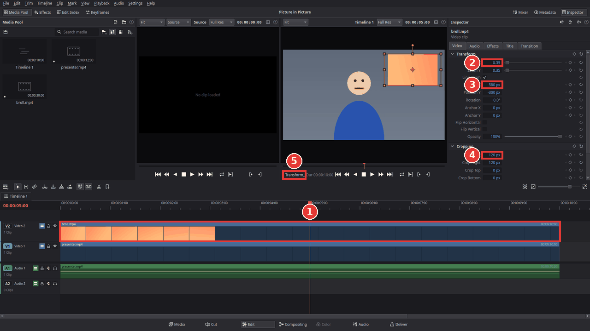

# Zoom, crop and picture-in-picture

You will make a clip bigger or smaller, move it, cut off its edges, and put a small video in a
corner over another one (a "picture-in-picture", for example a face cam over a screen
recording). All of this is in the **Transform** and **Cropping** sections of the Inspector.

## Zoom into a clip

1. Click the clip on the timeline.
2. Open the **Video** tab of the **Inspector** on the right.
3. Under **Transform**, raise **Zoom X**: **1.00** is the normal size, **1.50** is one and a half
   times as big. With **Link Zoom** ticked, **Zoom Y** follows, so the picture keeps its
   shape.
4. Change **Position X** (left and right) and **Position Y** (up and down) to choose which part
   of the enlarged picture is seen.

To change a value, type it, or drag left and right on the number (hold **Shift** for fine
steps). The round arrow at the end of a row puts it back to its default.

## Picture-in-picture

1. Put the main clip (the big picture) on track **V1**.
2. Put the second clip on track **V2**, above it, at the same time (1 in the picture below).
   The upper track covers the lower one, so for now you only see the V2 clip.
3. Click the V2 clip. In the Inspector, set **Zoom X** to about **0.35** (2). The clip gets
   small and the main clip appears around it.
4. Move it into a corner with **Position X** and **Position Y** (3), or drag it in the viewer
   (see below).
5. Optional: cut off its sides with **Crop Left** and **Crop Right** under **Cropping** (4),
   for example to make it narrower.

## Drag in the viewer instead of typing

Click the button at the bottom left of the viewer (5) and choose **On-Screen Transform
Controls**. A frame with handles appears around the selected clip in the viewer:
- drag inside the frame to move the clip;
- drag a corner or an edge to make it bigger or smaller;
- drag the round handle above the top edge to rotate it.

Choose **On-Screen Crop Controls** to crop by dragging the edges of the frame, and **Off** to
hide the handles again.

## Crop a clip

Under **Cropping**, **Crop Left**, **Crop Right**, **Crop Top** and **Crop Bottom** cut that
many pixels off each edge. What is cut off becomes transparent: on V1 it shows black, on V2 the
clip below.

To remove black bars from a clip (for example a 4:3 video in a 16:9 timeline), zoom in instead
until the bars are gone.

## Tips

- **A border or shadow around the picture-in-picture:** drag **Drop Shadow** from **Video
  Effects > Stylize** in the effects library onto the V2 clip.
- **Animate it:** a slow zoom or a picture-in-picture that slides in are made with keyframes;
  see [Animate with keyframes](keyframe-animation.md).
- **Mirror a clip:** tick **Flip Horizontal** under **Transform**.
- **Make it see-through:** lower **Opacity** under **Transform**.
- **Undo** a change with **Ctrl+Z**. To put the whole section back, click the round arrow in the
  title of **Transform** or **Cropping**.

## If something goes wrong

- **The small clip does not show.** It must be on a track *above* the main clip, at the same
  time. Check that the eye button of its track is on.
- **No handles in the viewer.** Select the clip on the timeline first, put the playhead over
  it, and choose **On-Screen Transform Controls** with the button at the bottom left of the
  viewer.
- **The zoomed picture is blurry.** Zooming enlarges the pixels; footage with a higher
  resolution than the timeline (for example 4K in a 1080p timeline) stays sharper.
