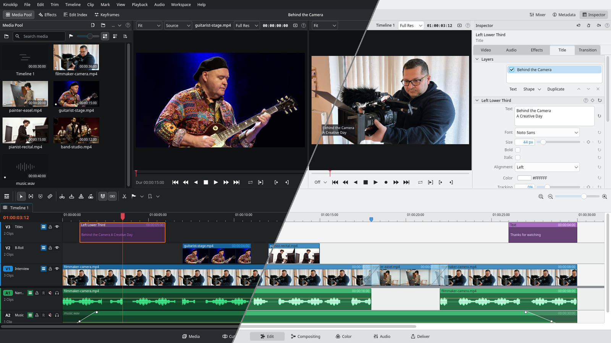
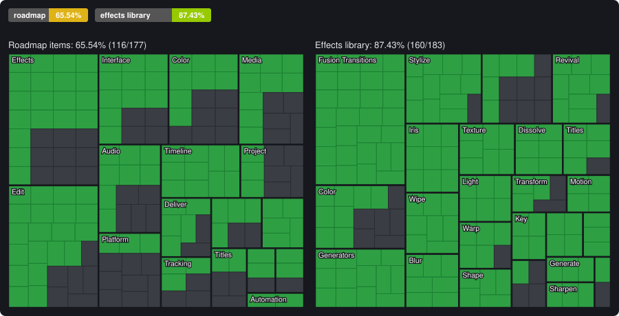
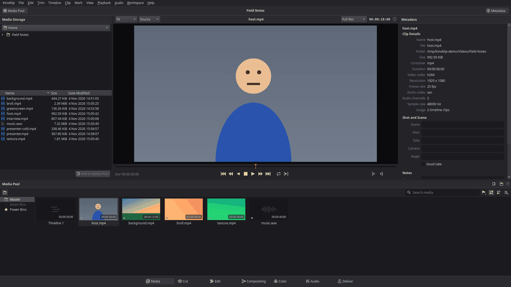
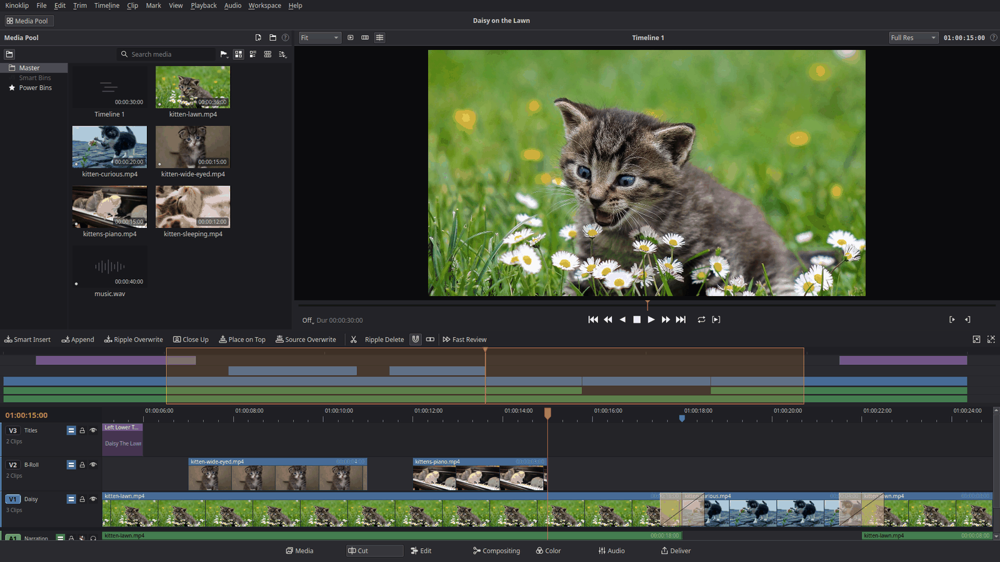
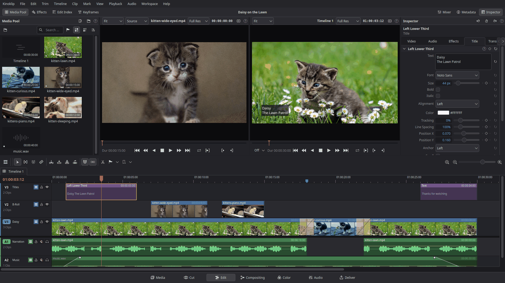
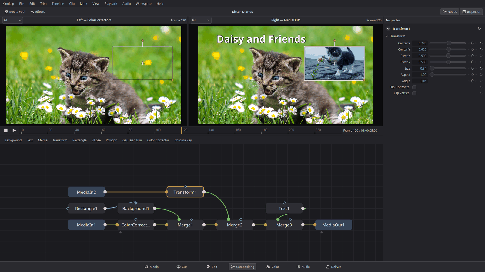
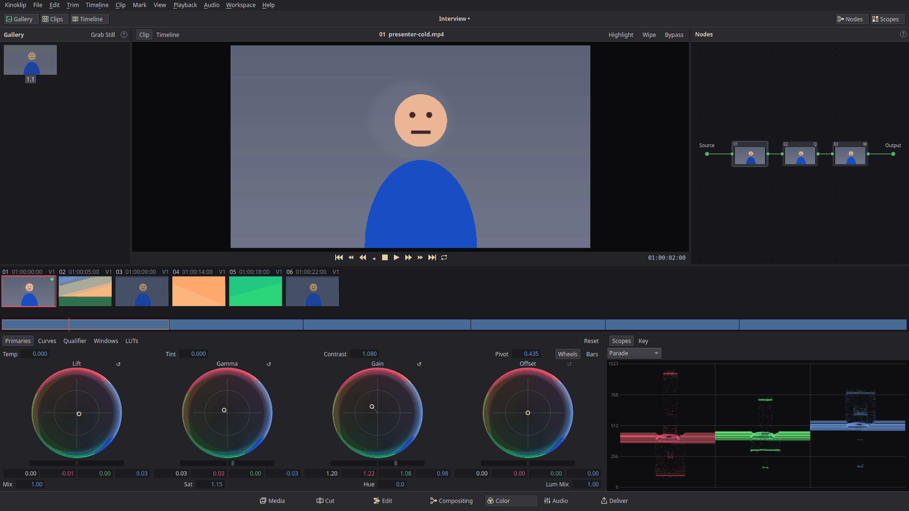
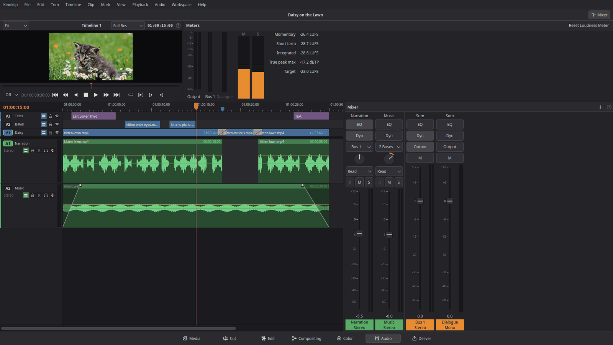
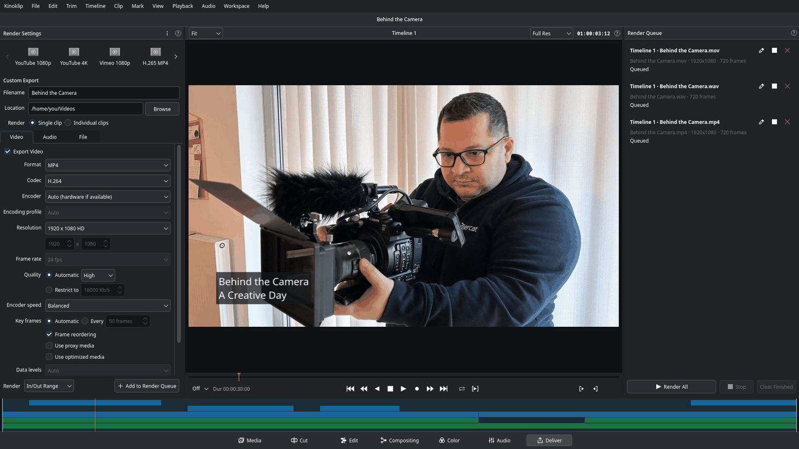
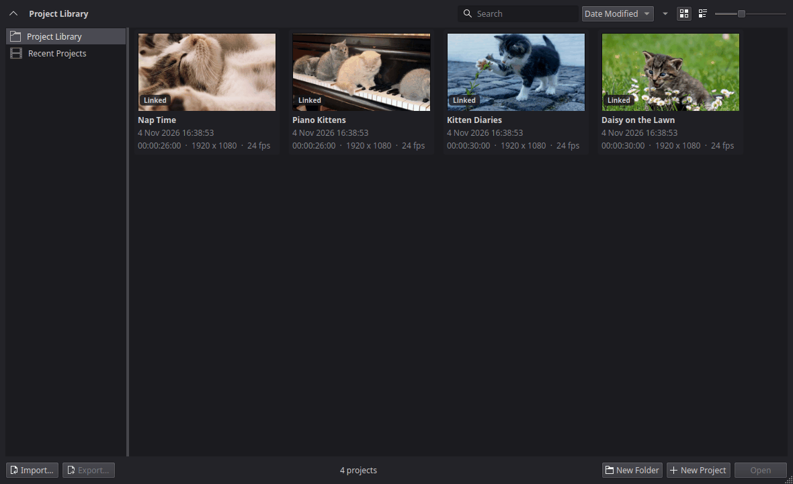

<h1 align="center"><a href="https://github.com/SeniorMatt/kinoklip/releases">Download here</a></h1>

<a href="docs/guide/readme.md">How to use Kinoklip</a>

<a href="https://discord.gg/pCeHnvDn3x"> Join our Discord</a>

A non-linear video editor written from scratch in C++20 with Qt 6 Widgets and FFmpeg. The layout,
behaviour and default shortcuts follow DaVinci Resolve's Edit page, with the KDE Breeze look.
Kinoklip is an independent project and is not affiliated with Blackmagic Design.

## Status

<!-- status:start -->

Green is done, grey is still to do. Details: [roadmap](docs/roadmap.md) and [effects library](docs/effects-library-status.md).
<!-- status:end -->

Kinoklip is still a beta: expect bugs and keep backups.

## Why use Kinoklip over Resolve?

**On Windows or macOS:** don't. Kinoklip isn't available there yet, and even when it is, Resolve
is the more complete and more mature editor. It's a great project, built and maintained by
people who are paid to work on it full time, and that's worth supporting. Its free version is
excellent, and buying Studio supports the people who made the workflow Kinoklip copies.

**On Linux,** Resolve runs, but its support is minimal: a short list of officially supported
distributions, NVIDIA-first GPU support, and no H.264 or H.265 in the free version. Kinoklip has
a few real advantages there:

- **Much lighter on modest hardware.** Kinoklip is a native C++ / Qt app that does only what an
  editor needs: it decodes with the GPU's own video engine (VA-API) on Intel and AMD, composites
  on the GPU with plain OpenGL, prepares the next clip before a cut, and keeps nothing running
  in the background that you didn't ask for. On a laptop with integrated graphics, keyframes,
  titles and animations play back without lag.
- **H.264, H.265 and AAC for free**, for import and export. Resolve's free version on Linux has
  none of them, and Studio adds H.264 and H.265 only with an NVIDIA GPU.
- **Any GPU with OpenGL 3.3**: AMD, Intel and NVIDIA, including integrated graphics, which
  Resolve doesn't officially support.
- **One AppImage**
- **Free and open source (GPL-3.0)**
- **The same layout and shortcuts as Resolve**

It is still a beta, missing many of Resolve's features, so it's not a full replacement yet.

## Screenshots

Show the screenshots

<table>
<tr>
<td width="50%" valign="top"> <b>Media</b></td>
<td width="50%" valign="top"> <b>Cut</b></td>
</tr>
<tr>
<td width="50%" valign="top"> <b>Edit</b></td>
<td width="50%" valign="top"> <b>Compositing</b></td>
</tr>
<tr>
<td width="50%" valign="top"> <b>Color</b></td>
<td width="50%" valign="top"> <b>Audio</b></td>
</tr>
<tr>
<td width="50%" valign="top"> <b>Deliver</b></td>
<td width="50%" valign="top"> <b>Project Manager</b></td>
</tr>
</table>

## Documentation

**Use it**
- [How to use Kinoklip](docs/guide/readme.md): short how-to guides
- [Resolve keymap](docs/keymap-resolve-windows.md): the default shortcuts
- [Keyboard presets](docs/keymaps/readme.md): Vegas Pro, Premiere Pro, Final Cut Pro, Avid Media Composer, Kdenlive, Shotcut and Vim / Neovim (modal keys on the timeline)
- [Menu reference](docs/menu-reference.md): every menu entry and panel, what it does
- [Release notes](docs/releases/): changes in each release
- [Privacy](docs/privacy.md): what Kinoklip keeps on your computer, and what a bug report can share

For developers: [building](docs/building.md), [contributing](docs/contributing.md) and [all documents](docs/readme.md).

## Community

Questions, ideas and your edits: join the [Kinoklip Discord server](https://discord.gg/pCeHnvDn3x)
(also in the app under Help > Join the Community on Discord). Bugs still go to
[GitHub issues](https://github.com/SeniorMatt/kinoklip/issues), so they don't get lost in chat.

## Support

If you want to support the project: [ko-fi.com/seniormatthew](https://ko-fi.com/seniormatthew), it will be much appreciated.

## License

The code is GPL-3.0-or-later, see [license.md](license.md). The Kinoklip name, icon and logos are
not under the GPL: forks must replace them, see [logo-license.md](logo-license.md). Release bundles
include GPL FFmpeg components; third-party notices are inside the bundle under
`usr/share/doc/kinoklip/`.

## Legal

- **Independent project.** Kinoklip is not affiliated with, sponsored by or endorsed by Blackmagic
  Design. DaVinci Resolve, Fusion, Fairlight and Blackmagic Design are trademarks or registered
  trademarks of Blackmagic Design Pty Ltd. They are named here only to describe the workflow and
  shortcuts Kinoklip follows. Other names (Qt, KDE, FFmpeg, YouTube, Vimeo and others) are
  trademarks of their owners.
- **Clean room.** Kinoklip is written from general knowledge of how Resolve behaves and from public,
  open specifications. It contains no Blackmagic code, icons, images, fonts, presets, LUTs or
  documentation text, and Resolve is never installed, run or decompiled to build it. The rules and
  their limits are in [docs/clean-room.md](docs/clean-room.md); every asset and its licence is in
  [attribution.md](attribution.md).
- **Privacy.** Kinoklip collects and sends nothing about you: no telemetry, analytics or automatic
  crash reports. A bug report shares system info only when you choose to, see
  [docs/privacy.md](docs/privacy.md).
- **No warranty.** Kinoklip is provided "as is", without any warranty, as stated in the GPL
  (sections 15 and 16 of [license.md](license.md)). It is beta software: keep backups.
- **Codecs and patents.** The AppImage includes FFmpeg with open-source codec libraries, so common
  formats work without extra downloads: H.264 (x264, OpenH264), H.265 / HEVC (x265), AAC (FFmpeg's
  own encoder), AV1 (dav1d, libaom, SVT-AV1), VP8 / VP9 (libvpx), Opus, Vorbis and MP3 (LAME).
  FFmpeg is built without its "non-free" option, so everything in the bundle can be shared under the
  GPL. Some of these formats, mainly H.264, H.265 and AAC, are covered by patents in some countries
  (for example the United States). Whether you need a patent licence to use them depends on where
  you live and what you do with them (personal or commercial use), and is your responsibility. This
  is general information, not legal advice. The full list of bundled libraries and their licences
  is in [attribution.md](attribution.md).

## AI disclosure

This project was built with AI: almost all of the code, tests and documentation were written by
AI, then checked and analysed by me, the project owner, who also directs and tests it. The icon
was drawn by hand.
**We aren't appreciating AI art here.**
