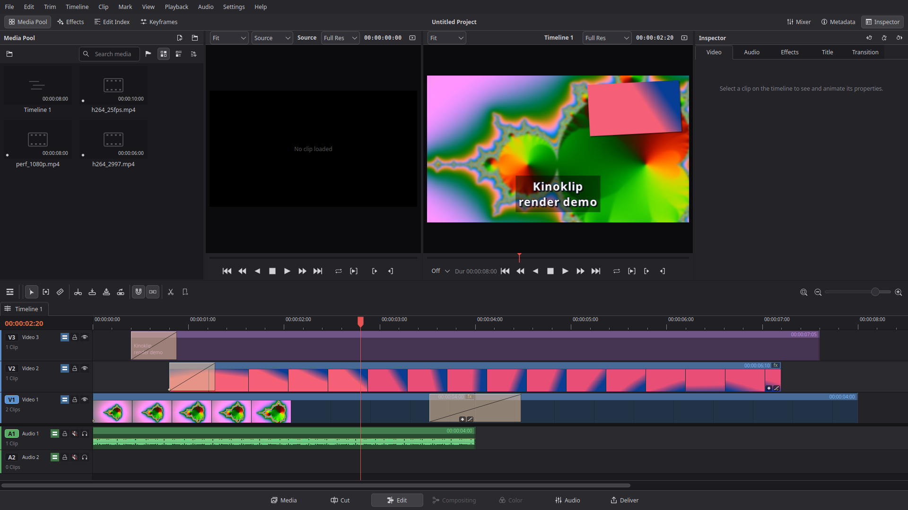

<h1 align="center">Kinoklip</h1>

<h1 align="center"><a href="https://github.com/SeniorMatt/kinoklip/releases">Download here</a></h1>

A non-linear video editor written from scratch in C++20 with Qt 6 Widgets and FFmpeg. The layout,
behaviour and default shortcuts follow DaVinci Resolve's Edit page, with the KDE Breeze look.
Kinoklip is an independent project and is not affiliated with Blackmagic Design.

All releases are alpha or beta pre-releases for now: expect bugs and keep backups.

## Documentation

- [Building](docs/building.md): build from source (Arch container or host Qt), useful command-line options
- [Contributing](docs/contributing.md): guidelines for code, shortcuts, naming and tests
- [Coding style](docs/coding-style.md): naming, comments, file layout
- [Directory map](docs/directory-map.md): what lives where in the source tree
- [Roadmap](docs/roadmap.md): the milestones ahead
- [Plan and architecture](plan.md): module contracts and design rules
- [Behaviour spec](docs/behavior-spec.md): how each feature behaves, with test references
- [Resolve keymap](docs/keymap-resolve-windows.md): default keyboard shortcuts
- [Release notes](docs/releases/): changes in each release
- [Linux packaging](packaging/linux/readme.md): building the `.run` and portable bundle

## License
GPL-3.0-or-later, see [license.md](license.md). Release bundles include GPL FFmpeg components;
third-party notices are inside the bundle under `usr/share/doc/kinoklip/`.

## AI disclosure
This project was built entirely with AI: the code, tests and documentation were written by
Anthropic's Claude (Claude Code), directed and tested by the project owner.
